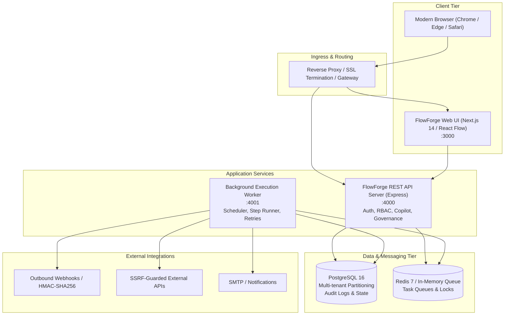

# FlowForge — Resilient Multi-Tenant Business Workflow Automation Platform

[](https://github.com/soumikbur/FlowForge/actions/workflows/ci.yml)
[](https://soumikbur.github.io/FlowForge/)
[](https://render.com/deploy?repo=https://github.com/soumikbur/FlowForge)
[](https://nodejs.org/)
[](https://pnpm.io/)
[](https://www.typescriptlang.org/)
[](https://nextjs.org/)
[](https://tailwindcss.com/)
[](https://reactflow.dev/)
[](https://www.prisma.io/)
[](https://www.postgresql.org/)
[](https://redis.io/)
[](https://vitest.dev/)
[](./LICENSE)

FlowForge is an enterprise-grade, resilient, multi-tenant business workflow automation platform built with modern TypeScript across frontend applications, distributed API services, and resilient background execution workers.

It empowers organizations to design, simulate, govern, execute, and monitor critical operational workflows through an intuitive drag-and-drop visual canvas, durable execution state machines, human-in-the-loop approvals, AI-assisted authoring, and secure external connectors.

> 🌐 **Live Portal & Interactive Architecture Explorer:** Explore the live documentation portal and 3D force-directed knowledge graph (3,158 AST nodes, 6,239 connections) at **[https://soumikbur.github.io/FlowForge/](https://soumikbur.github.io/FlowForge/)**.

---

## Architecture Overview

FlowForge is architected as an audited monorepo structured around separation of concerns, strict boundary enforcement, and defense-in-depth security:

```
FlowForge/
├── apps/
│   ├── web/                     # Next.js 14 App Router, React Flow builder, Tailwind CSS dual theme
│   ├── api/                     # Express REST API, RBAC, OAuth 2.0, Webhook engine, AI Copilot
│   └── worker/                  # Resilient background execution runner, BullMQ queues, Fair scheduler
├── packages/
│   ├── database/                # Prisma ORM schema (20+ models), PostgreSQL migrations, client
│   ├── workflow-engine/         # Pure graph validation, topological planner, state machine, hasher
│   ├── integrations/            # SSRF-guarded HTTP client, Slack & SMTP connectors, Webhook dispatch
│   ├── shared/                  # Zod schemas, API contracts, domain models, RBAC permissions
│   ├── config/                  # Validated environment configuration loader
│   └── test-utils/              # In-memory transactional test store, fixtures, mock providers
├── scripts/                     # Production migration runner (db-migrate.js)
├── tests/                       # 873 automated unit, integration, and security tests (52 suites)
├── docs/                        # Architecture, OpenAPI, Runbooks, Disaster Recovery, Compliance guides
├── docker-compose.yml           # Local multi-service development orchestration
└── docker-compose.prod.yml      # Hardened production container topology with network isolation
```

### System Architecture Diagram



---

## Verified Feature Inventory

| Capability                        | Implementation Status | Description                                                                                                                                           |
| :-------------------------------- | :-------------------: | :---------------------------------------------------------------------------------------------------------------------------------------------------- |
| **Visual Workflow Builder**       | **Production Ready**  | Drag-and-drop workflow canvas built on React Flow with interactive node palette, validation overlays, pan/zoom controls, and minimap.                 |
| **Node Handler Ecosystem**        | **Production Ready**  | Handlers for `TRIGGER`, `CONDITION`, `HTTP_REQUEST`, `EMAIL`, `APPROVAL`, `DELAY`, `TRANSFORM`, and `END`.                                            |
| **Durable State Machine**         | **Production Ready**  | Deterministic workflow execution states: `QUEUED`, `RUNNING`, `WAITING_APPROVAL`, `WAITING_DELAY`, `RETRYING`, `SUCCEEDED`, `FAILED`, `CANCELLED`.    |
| **Human-in-the-Loop Inbox**       | **Production Ready**  | Dedicated approvals inbox (`/approvals`) allowing authorized reviewers to inspect runtime payload, leave audit comments, and approve or reject steps. |
| **Global Theme System**           | **Production Ready**  | Cohesive dual-theme architecture (Light & Dark) backed by semantic CSS tokens, zero-flash pre-hydration script, and persistent user selection.        |
| **Enterprise Connectors**         | **Production Ready**  | Pre-built integrations for HTTP REST APIs, Slack webhooks, and SMTP email with credential vault encryption (AES-256-GCM).                             |
| **Workflow Templates**            | **Production Ready**  | Reusable automation templates catalog (`/templates`) with category filtering, search, and one-click instantiation.                                    |
| **Simulation & Debugging**        | **Production Ready**  | Dry-run execution engine (`/workflows/[id]/test`) with mock input fixtures, step-by-step telemetry, and state inspection.                             |
| **Process Intelligence**          | **Production Ready**  | Workflow discovery, bottleneck detection, SLA violation tracking, and operational efficiency analytics (`/analytics`).                                |
| **AI Workflow Copilot**           | **Production Ready**  | Natural language workflow generation, node auto-configuration, and schema mapping powered by provider abstraction.                                    |
| **Resource Governance & Quotas**  | **Production Ready**  | Per-organization execution quotas, connector call limits, rate limiters, and fair scheduling controls (`/quotas`).                                    |
| **SSO, SCIM & RBAC**              | **Production Ready**  | Multi-tenant organization scoping, SAML/OIDC SSO configuration, SCIM 2.0 user/group provisioning, and fine-grained RBAC (`OWNER`, `ADMIN`, `MEMBER`). |
| **Event Streaming & Outbox**      | **Production Ready**  | Guaranteed at-least-once transactional outbox event delivery with Dead Letter Queue (DLQ) replay capability.                                          |
| **Resilience & Request Draining** | **Production Ready**  | Graceful SIGTERM/SIGINT shutdown, in-flight request draining, and `/health/live` & `/health/ready` Kubernetes probes.                                 |

---

## Technology Stack

| Layer                      | Technologies & Frameworks                                                      |
| :------------------------- | :----------------------------------------------------------------------------- |
| **Frontend Application**   | Next.js 14 (App Router), React 18, React Flow 11, Tailwind CSS 3, Lucide React |
| **Backend API Services**   | Node.js 22+, Express 4, Zod, Bcrypt, JsonWebToken, Supertest                   |
| **Background Processing**  | Node.js Worker, BullMQ / In-Memory Task Queue, Distributed Locks               |
| **Persistence & Database** | PostgreSQL 16, Prisma ORM 6.3, Transactional Schemas                           |
| **Caching & Messaging**    | Redis 7, Pub/Sub Event Streaming, Transactional Outbox                         |
| **Tooling & Monorepo**     | pnpm 12 workspaces, TypeScript 5.7, Prettier 3, ESLint 9, Vitest 3             |
| **Containerization**       | Docker, Docker Compose, Multi-stage unprivileged Alpine containers             |

---

## Prerequisites

Before setting up FlowForge locally or in production, ensure your environment meets these requirements:

- **Node.js**: `v22.0.0` or higher (verified on Node.js `v24.19.0`)
- **pnpm**: `v12.0.0` or higher (verified on pnpm `v12.16.1`)
- **PostgreSQL**: `v16.x` (or Docker)
- **Redis**: `v7.x` (or Docker)
- **Docker & Docker Compose**: Recommended for containerized infrastructure and production deployment

---

## Installation & Setup

### 1. Clone the Repository

```bash
git clone https://github.com/soumikbur/FlowForge.git
cd FlowForge
```

### 2. Install Workspace Dependencies

```bash
pnpm install --frozen-lockfile
```

### 3. Generate Database Client

```bash
pnpm db:generate
```

### 4. Configure Environment Variables

Create your local `.env` file from the comprehensive template:

```bash
cp .env.example .env
```

Ensure cryptographic keys are generated with adequate entropy:

```bash
# Generate 256-bit hexadecimal key for ENCRYPTION_KEY (64 hex characters)
node -e "console.log(require('crypto').randomBytes(32).toString('hex'))"

# Generate high-entropy string for SESSION_SECRET & JWT_SECRET (32+ chars)
node -e "console.log(require('crypto').randomBytes(32).toString('base64'))"
```

---

## Local Development

Start the platform locally using the unified development command or individual microservices:

```bash
# Start all services concurrently (Web, API, Worker)
pnpm dev

# Or launch individual services in separate terminals:
pnpm dev:api       # Express REST API (Port 4000)
pnpm dev:worker    # Background Worker (Port 4001)
pnpm dev:web       # Next.js Web Frontend (Port 3000)
```

### Service Endpoints

- **Web Frontend Application**: [http://localhost:3000](http://localhost:3000)
- **REST API Base URL**: [http://localhost:4000](http://localhost:4000)
- **API Liveness Probe**: [http://localhost:4000/health/live](http://localhost:4000/health/live)
- **API Readiness Probe**: [http://localhost:4000/health/ready](http://localhost:4000/health/ready)
- **Worker Health Probe**: [http://localhost:4001/health](http://localhost:4001/health)

---

## Database Management

FlowForge leverages Prisma ORM with strict migration controls and production pre-flight checks:

```bash
# Launch PostgreSQL and Redis using Docker Compose
pnpm db:up

# Deploy pending migrations (Development)
pnpm db:migrate

# Seed development database with initial tenant, admin user, and sample workflows
pnpm db:seed

# Production-safe migration deployment (validates connection strings & executes prisma deploy)
pnpm db:migrate:prod

# Stop containerized database services
pnpm db:down
```

---

## Automated Verification & Testing

The repository maintains 100% passing test coverage across 52 test suites and 873 automated tests:

```bash
# Run the complete test suite
pnpm test

# Run unit tests only
pnpm test:unit

# Run API and workflow integration tests
pnpm test:integration

# Run security, tenant-isolation, and SSRF penetration tests
pnpm test:security

# TypeScript compiler validation across all workspaces
pnpm typecheck

# Code formatting and static lint analysis
pnpm format
pnpm lint

# Production monorepo build verification
pnpm build
```

---

## Production Deployment Options

FlowForge supports several certified production deployment topologies:

### Option 1: 1-Click Cloud Deployment via Render Blueprint

Deploy the complete multi-service architecture (PostgreSQL, Redis, API, Worker, and Web Frontend) with one click using the included [`render.yaml`](./render.yaml):

[](https://render.com/deploy?repo=https://github.com/soumikbur/FlowForge)

1. Click the button above or visit [Render Blueprints](https://dashboard.render.com/blueprints).
2. Connect your GitHub repository: `https://github.com/soumikbur/FlowForge`.
3. Render automatically provisions the managed PostgreSQL 16 database, Redis queue store, API service, background execution worker, and web frontend.

### Option 2: Production Multi-Container Docker Compose

Deploy the complete hardened container topology configured in [`docker-compose.prod.yml`](./docker-compose.prod.yml):

```bash
# Clone the repository
git clone https://github.com/soumikbur/FlowForge.git
cd FlowForge

# Configure production environment variables
cp .env.example .env.production
# Edit .env.production with your secure secrets

# Build and start all 5 services with internal network isolation
docker compose -f docker-compose.prod.yml up -d --build
```

### Option 3: Pre-Built Containers from GitHub Container Registry (GHCR)

Pull verified multi-stage production container images directly from GitHub Packages:

```bash
docker pull ghcr.io/soumikbur/flowforge/api:latest
docker pull ghcr.io/soumikbur/flowforge/worker:latest
docker pull ghcr.io/soumikbur/flowforge/web:latest
```

### Container Topology & Security Hardening

- **Unprivileged Execution:** Application containers run under an unprivileged user (`flowforge:flowforge` UID/GID 1001).
- **Network Isolation:** PostgreSQL and Redis reside on an internal network (`flowforge-internal`) that is not exposed to the public internet or external host ports.
- **Reverse Proxy Protection:** The API and Web services bind to `127.0.0.1` behind an SSL-terminating reverse proxy (Nginx, Caddy, Cloudflare, or AWS ALB).
- **Resource Constraints:** Explicit CPU and memory limits prevent denial-of-service and "noisy neighbor" starvation.
- **Log Rotation:** JSON-file logging drivers are configured with maximum file sizes (`20m` - `50m`) and rotation limits (`3` - `5` files).
- **Health Probes:** Docker health checks poll `/health/live` and `/health/ready` to ensure seamless zero-downtime rolling updates.

---

## Security Practices

1. **SSRF Defense:** All external HTTP connector nodes resolve domains and filter IP addresses before request dispatch, rejecting loopback, RFC 1918 private subnets, link-local, and cloud metadata IPs (`169.254.169.254`).
2. **Credential Encryption at Rest:** Third-party credentials, tokens, and secrets are encrypted with AES-256-GCM using unique initialization vectors (IVs) and authentication tags.
3. **Data Redaction:** Execution logs and error payloads pass through automated redaction filters to scrub authorization headers, cookies, and bearer tokens.
4. **Role-Based Access Control:** Every API route verifies tenant boundaries (`organizationId`) and user permissions (`OWNER`, `ADMIN`, `MEMBER`).
5. **Rate Limiting & Abuse Defense:** Tiered sliding-window rate limiters protect public API routes and webhook receivers against brute-force attacks and abuse.

For reporting vulnerabilities, consult [`SECURITY.md`](./SECURITY.md).

---

## Troubleshooting Guide

| Issue                                    | Root Cause                                                     | Resolution                                                                                                                    |
| :--------------------------------------- | :------------------------------------------------------------- | :---------------------------------------------------------------------------------------------------------------------------- |
| **Port `3000` / `4000` / `4001` in use** | A dangling development process or prior container is active    | Run `Get-NetTCPConnection -LocalPort <PORT>` on Windows or `lsof -i :<PORT>` on Linux/macOS and terminate the orphan process. |
| **Missing Prisma Client**                | Client was not generated after fresh installation              | Run `pnpm db:generate` to regenerate `@prisma/client`.                                                                        |
| **Database connection refused**          | PostgreSQL service is stopped or DATABASE_URL is misconfigured | Run `pnpm db:up` to start containerized Postgres or verify connection string credentials in `.env`.                           |
| **Prettier formatting error in CI**      | File modified without adhering to workspace code style         | Run `pnpm format:fix` to automatically format all files before committing.                                                    |
| **TypeScript compile error on build**    | Shared package dependency not compiled in order                | Run `pnpm build` from the repository root to trigger topological dependency compilation.                                      |

---

## Contributing

We welcome community contributions. Please review [`CONTRIBUTING.md`](./CONTRIBUTING.md) for our branching model, commit conventions, and pull request guidelines.

---

## License

This project is licensed under the **MIT License**. See the [`LICENSE`](./LICENSE) file for details.
