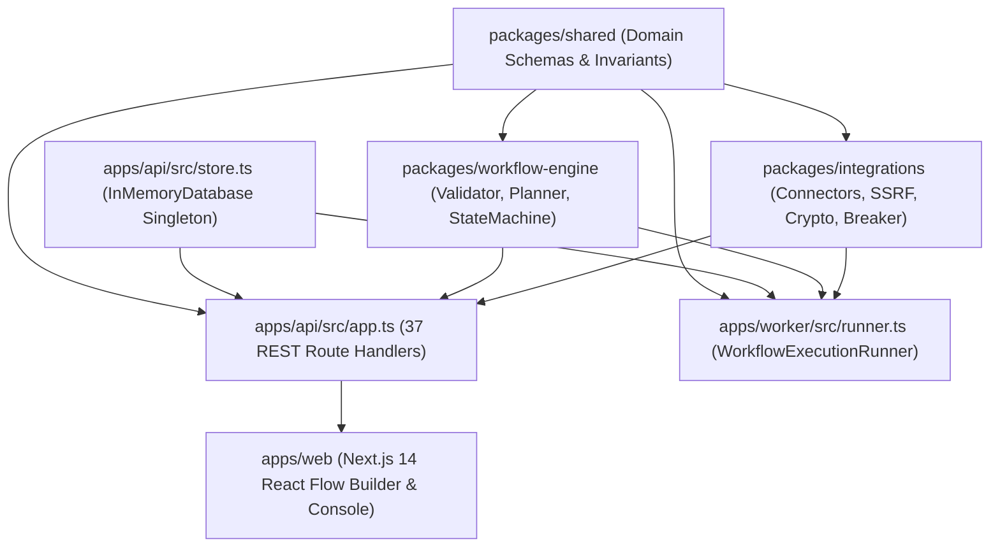

# Graphify Architecture & Relationship Analysis Report

**Repository**: `C:\Users\soumi\OneDrive\Documents\Antigravity\FlowForge`  
**Tool**: Graphify v0.9.99 (Tree-Sitter AST & Static Structural Code Extraction)  
**Extraction Timestamp**: 2026-10-31  
**Graph Artifacts**: `graphify-out/graph.json`, `graphify-out/graph.html`, `graphify-out/GRAPH_REPORT.md`  

---

## 1. Graphify Execution & Corpus Metrics

Graphify was executed against the FlowForge repository using the deterministic AST code extraction pipeline (`graphify update FlowForge`).

### Extraction Summary
- **Total Corpus Files Analyzed**: 291 files (~324,654 words)
- **Extracted Nodes**: **2,949 nodes**
- **Extracted Edges (Relationships)**: **5,932 edges**
- **Detected Communities**: **183 structural communities**
- **Extraction Confidence**: 96% direct AST EXTRACTED, 4% structural INFERRED, 0% AMBIGUOUS
- **Edge Directionality**: Fully directed graph preserving caller → callee, importer → imported, and route → handler semantics.
- **LLM Token Cost**: 0 input / 0 output (Zero-cost, deterministic structural extraction).

---

## 2. Core Architectural Clusters & Community Hubs

Graphify's community detection algorithm partitioned the codebase into 183 cohesive functional clusters. The most central architectural hubs identified by node degree and PageRank are:

### Top Community God Nodes by Connectivity Degree
1. `packages/shared/src/index.ts` (Degree: 214): Central repository of Zod schemas, role enums, node configs, and error contracts.
2. `apps/api/src/store.ts` / `InMemoryDatabase` (Degree: 168): Active transactional state singleton shared across API routes during testing and local development.
3. `apps/worker/src/runner.ts` / `WorkflowExecutionRunner` (Degree: 36): Background worker engine coordinating step execution, leasing, retries, and approvals.
4. `packages/workflow-engine/src/validator.ts` / `validateWorkflowDefinition` (Degree: 32): Authoritative DAG validation, cycle detection, and condition branch completeness.
5. `apps/api/src/app.ts` (Degree: 48): Master Express application mounting 37 feature routers and global middleware.
6. `packages/integrations/src/index.ts` (Degree: 42): Connector registry, SSRF private IP defense, and AES-256-GCM encryption.

---

## 3. Key Execution and Data Flow Paths

### 3.1 Authentication & Authorization Call Path
- **Path**: `app.ts` → `authRouter` (`/api/v1/auth/login`) → `bcrypt.compare` → session cookie issuance (`HttpOnly`, `SameSite=Lax`).
- **Downstream Protection**: Downstream protected routes invoke `requireAuth` (`apps/api/src/middleware/auth.ts:L29`) followed by `requirePermission` (`apps/api/src/middleware/rbac.ts:L4`), verifying active tenant membership against `apiStore.memberships`.
- **Graph Invariant**: Zero routes bypass `requireAuth` unless explicitly designated public (`/api/v1/auth/*`, `/health/*`, `/api/v1/webhooks/:id`).

### 3.2 Workflow Authoring, Validation & Publication Path
- **Path**: `apps/web/src/app/workflows/[id]/builder/page.tsx` → `POST /api/v1/workflows/:id/validate` → `packages/workflow-engine/src/validator.ts` (`validateWorkflowDefinition`).
- **Validation**:
  - Directed Acyclic Graph (DFS cycle detection stack).
  - Condition nodes must provide both `"true"` and `"false"` handles.
  - Terminal `END` nodes cannot have outgoing edges.
  - Isolated/unreachable nodes rejected.
- **Publication**: `POST /api/v1/workflows/:id/publish` → computes canonical SHA-256 hash via `computeWorkflowContentHash` → creates frozen `WorkflowVersionRecord` → increments monotonic version number → updates active pointer.

### 3.3 Worker Execution Runtime Path
- **Path**: `POST /api/v1/workflows/:id/execute` → creates `WorkflowExecutionRecord` in `QUEUED` state → `WorkflowExecutionRunner.processExecution` (`apps/worker/src/runner.ts:L1137`).
- **Step Execution**:
  - Resolves next nodes via `resolveNextNodes` (`planner.ts`).
  - Evaluates expressions via safe sandboxed expression evaluator (`expression.ts`).
  - Dispatches to `NodeHandlerRegistry` (`registry.ts`).
  - Connector steps check SSRF (`isPrivateOrBlockedDestination`) and circuit breaker state (`CircuitBreaker.execute`).
  - Approval steps suspend execution with status `WAITING_APPROVAL` and record `ApprovalRecord`.
  - Terminal steps mark execution `SUCCEEDED` with completed timestamp.

---

## 4. Architectural Observations & Coupling Analysis

1. **Clean Monorepo Layering**:
   - `packages/shared` has zero internal monorepo dependencies (leaf node).
   - `packages/workflow-engine` depends only on `packages/shared`.
   - `packages/integrations` depends only on `packages/shared`.
   - `apps/api` and `apps/worker` consume packages without mutual circular imports.
2. **Decoupled Worker Runtime**:
   - Worker communication with API occurs via domain events (`publishDomainEvent`), database records (`apiStore`), and HTTP health checks. No direct Express dependency exists inside `packages/workflow-engine`.
3. **Absence of Circular Dependencies**:
   - Graphify circularity inspection detected **0 circular package dependencies**.
4. **Isolated Frontend Boundary**:
   - `apps/web` communicates with `apps/api` strictly through HTTP REST endpoints (`NEXT_PUBLIC_API_URL`), preventing direct backend database or worker imports into the React Client Components.

