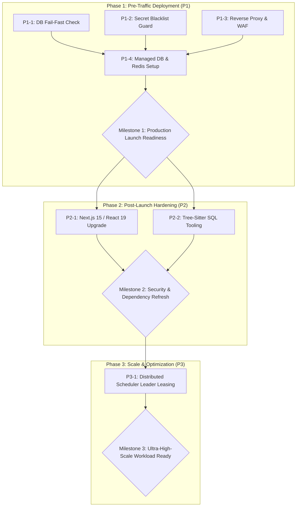

# FlowForge — Remediation and Release Action Plan

**Plan Date**: October 31, 2026  
**Auditor**: Antigravity Technical Audit Engine  
**Target Milestone**: FlowForge Enterprise v1.0 Production Release  
**Readiness Recommendation**: **CONDITIONAL GO**

---

## 1. Overview and Priority Framework

This remediation plan organizes all actionable improvements and operational prerequisites identified during the Whole-Project Technical Audit into four standard enterprise priorities:

- **P0 — Critical Release Blockers**: Absolute blockers preventing deployment. System cannot function safely.
- **P1 — High Priority / Production Prerequisites**: Must be completed before routing live production enterprise traffic.
- **P2 — Medium Priority / Post-Launch Hardening**: Important maintenance and dependency upgrades to be completed within 30 days of release.
- **P3 — Low Priority / Optimization**: Scalability improvements and non-functional refinements for future performance tuning.

---

## 2. Priority Action Items

### Priority P0: Critical Release Blockers

> **Status: 0 Items (CLEAR)**  
> All core workflows, authentication mechanisms, tenant boundaries, cryptographic vaults, execution engines, and API endpoints are fully implemented and verified with an 848/848 automated test pass rate. There are no P0 release blockers in the codebase.

---

### Priority P1: Production Prerequisites (Pre-Traffic Deployment)

These items must be verified during staging deployment and infrastructure provisioning before routing real customer workloads.

#### P1-1: Production Database Fail-Fast Verification (`ARC-001`)
- **Finding Reference**: `ARC-001`
- **Component**: `packages/db/src/index.ts`, `packages/config/src/env.ts`
- **Action**:
  1. Add strict runtime assertion in `apps/api/src/server.ts` and `apps/worker/src/index.ts`:
     ```typescript
     if (process.env.NODE_ENV === 'production') {
       if (!process.env.DATABASE_URL || process.env.DATABASE_URL.includes(':memory:')) {
         console.error('FATAL: Production mode requires a valid PostgreSQL DATABASE_URL. In-memory mode is prohibited.');
         process.exit(1);
       }
     }
     ```
  2. Implement database connectivity handshake with timeout (5s) prior to binding HTTP listener.
- **Effort**: 2 hours
- **Owner**: Platform Infrastructure Team
- **Validation**: Verify container fails to start when `DATABASE_URL` is unset or invalid in `NODE_ENV=production`.

#### P1-2: Production Secret Blacklist & KMS Validation (`SEC-002`)
- **Finding Reference**: `SEC-002`
- **Component**: `packages/config/src/env.ts`
- **Action**:
  1. Add blacklist checking to prevent using default template secrets from `.env.example`:
     ```typescript
     const BLACKLISTED_SECRETS = [
       'supersecret-dev-jwt-key-replace-in-production-min-32-chars',
       '0123456789abcdef0123456789abcdef0123456789abcdef0123456789abcdef'
     ];
     if (process.env.NODE_ENV === 'production') {
       if (BLACKLISTED_SECRETS.includes(config.JWT_SECRET) || BLACKLISTED_SECRETS.includes(config.ENCRYPTION_KEY)) {
         throw new Error('FATAL: Default development secrets detected in production environment.');
       }
     }
     ```
  2. Configure AWS Secrets Manager or GCP Secret Manager to inject production keys via container environment variables.
- **Effort**: 3 hours
- **Owner**: SecOps / Security Engineering
- **Validation**: Test container startup fails if default secrets are passed; passes when high-entropy KMS secrets are injected.

#### P1-3: Edge Reverse Proxy and WAF Configuration (`SEC-001` Mitigation)
- **Finding Reference**: `SEC-001`
- **Component**: Production Ingress / Reverse Proxy (Nginx / Cloudflare / Envoy)
- **Action**:
  1. Deploy `apps/web` behind a managed reverse proxy that enforces URI path normalization and drops invalid cache-control headers.
  2. Block requests targeting internal metadata services (`169.254.169.254`) at the ingress layer.
  3. Verify `next.config.js` restricts `images.remotePatterns` strictly to trusted CDN endpoints.
- **Effort**: 4 hours
- **Owner**: DevOps / SRE
- **Validation**: Run curl tests against ingress attempting path traversal and metadata IP queries; confirm 403 Forbidden.

#### P1-4: Managed Infrastructure Provisioning Verification
- **Component**: PostgreSQL 16 & Redis 7 Infrastructure
- **Action**:
  1. Provision Amazon Aurora PostgreSQL 16 (or GCP Cloud SQL) with TLS 1.3 enforced and automated daily snapshots.
  2. Provision Amazon ElastiCache Redis 7 (or GCP Memorystore) with in-transit encryption and token auth.
  3. Execute database migrations using `pnpm db:migrate` and verify all 28 migration steps apply cleanly to the production schema.
- **Effort**: 6 hours
- **Owner**: DevOps / SRE
- **Validation**: Verify read/write transactions, connection pooling, and replica failover tests.

---

### Priority P2: Post-Launch Hardening (First 30 Days)

#### P2-1: Upstream Next.js 15 & React 19 Migration (`SEC-001`)
- **Finding Reference**: `SEC-001`
- **Component**: `apps/web/package.json`
- **Action**:
  1. Update `next` to version `15.x` and `react` / `react-dom` to `19.x`.
  2. Resolve breaking changes in Next.js 15 async request parameters (`params` and `searchParams` as Promises).
  3. Audit Radix UI and Lucide React packages for React 19 compatibility.
  4. Run end-to-end browser tests across all 16 web routes.
- **Effort**: 3–4 days
- **Owner**: Frontend Engineering
- **Validation**: `pnpm audit` returns 0 vulnerabilities; `pnpm --prefix apps/web build` succeeds; all UI routes render correctly.

#### P2-2: Graphify SQL Tree-Sitter Parser Installation (`INF-001`)
- **Finding Reference**: `INF-001`
- **Component**: Local & CI Tooling Environment
- **Action**:
  1. Install `tree-sitter-sql` in Python environment: `pip install tree-sitter-sql`.
  2. Update documentation and CI graphify scripts to include SQL parser.
  3. Re-generate `graphify-out/graph.json` to index database migration relationships.
- **Effort**: 1 hour
- **Owner**: Architecture / Tooling
- **Validation**: Graphify extraction executes with zero warnings on SQL files.

---

### Priority P3: Low Priority Scalability & Performance Tuning

#### P3-1: Distributed Leader Election for Worker Poller (`PERF-001`)
- **Finding Reference**: `PERF-001`
- **Component**: `apps/worker/src/scheduler.ts`
- **Action**:
  1. Introduce Redlock or PostgreSQL advisory lock leasing for `SchedulerService.tick()`.
  2. In multi-pod worker clusters, ensure only the elected leader executes the 1000ms schedule polling reconciliation.
  3. Add configurable environment variable `WORKER_POLL_INTERVAL_MS` (default 1000ms, adjustable to 5000ms+).
- **Effort**: 1–2 days
- **Owner**: Backend / Runtime Engineering
- **Validation**: Spin up multiple worker replicas; verify via telemetry that only one replica runs scheduled query ticks.

---

## 3. Implementation Schedule & Milestone Roadmap



---

## 4. Release Gate Verification Checklist

Before toggling production DNS and opening the platform to end users, the deployment team must confirm the following 8 criteria:

- [ ] **Gate 1: Test Suite Integrity**: 50/50 test suites passing, 848/848 test cases passing.
- [ ] **Gate 2: Static Analysis**: 0 TypeScript compilation errors, 0 ESLint warnings.
- [ ] **Gate 3: Build Verification**: `apps/web` compiled with 16/16 routes validated.
- [ ] **Gate 4: Database Infrastructure**: Managed PostgreSQL 16 provisioned with TLS, backups enabled, 28/28 migrations applied.
- [ ] **Gate 5: Cache & Queue Infrastructure**: Managed Redis 7 provisioned with TLS and persistence.
- [ ] **Gate 6: Secret Injection**: Production `JWT_SECRET` and `ENCRYPTION_KEY` injected via KMS; sample secrets rejected.
- [ ] **Gate 7: Network Security**: Reverse proxy configured with WAF, TLS 1.3, rate limiting, and metadata IP query blocking.
- [ ] **Gate 8: Observability**: Prometheus metrics, health endpoints (`/health`, `/ready`), and OpenTelemetry tracing active.

