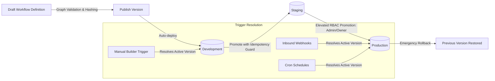
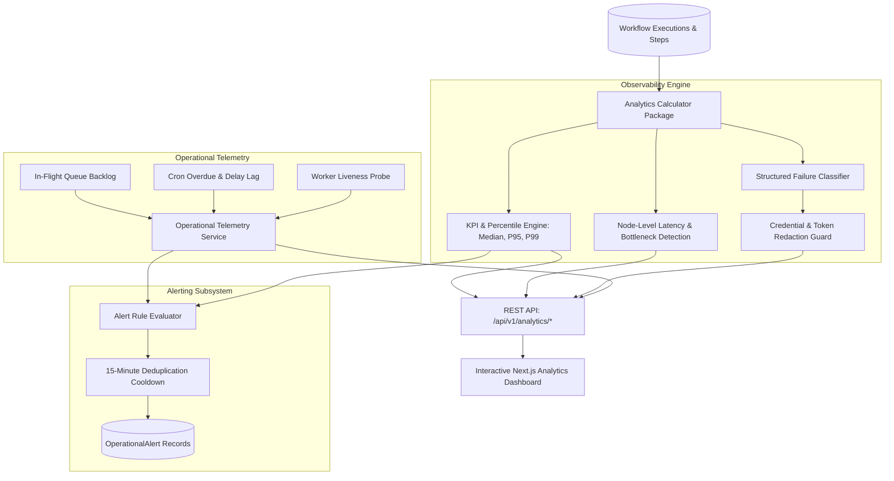
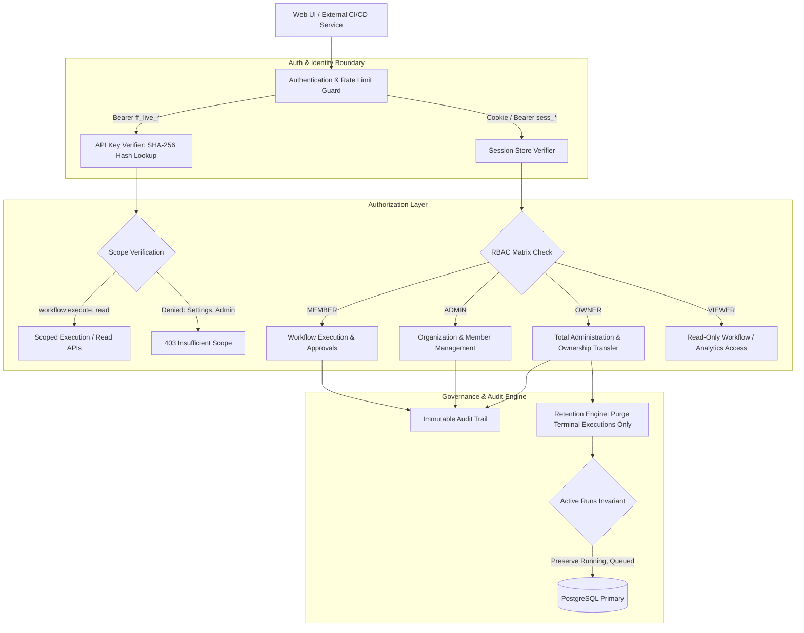

# FlowForge Architecture

## 1. System Overview

FlowForge is a resilient, multi-tenant business workflow automation platform built with modern TypeScript across both backend services and frontend applications.

## 2. Monorepo Structure & Boundaries

The codebase is structured as a pnpm monorepo with distinct separation of concerns:

- `apps/web`: Next.js frontend with Tailwind CSS and React Flow for visual workflow editing, execution monitoring, approval inbox, and dashboard.
- `apps/api`: Node.js Express API providing authenticated REST endpoints for workflows, versions, executions, approvals, credentials, and webhooks.
- `apps/worker`: BullMQ background worker executing discrete workflow tasks, handling retries, polling delays, and resilient state recovery.
- `packages/database`: Prisma schema, migrations, connection pooling, and multi-tenant repository abstractions.
- `packages/shared`: Universal domain types, Zod schemas, error definitions, and constants shared across client and server.
- `packages/workflow-engine`: Core pure engine logic (graph validation, topological sort, DAG cycle detection, condition evaluation, and execution state transitions). Has zero dependencies on HTTP or UI frameworks.
- `packages/integrations`: Connectors for Webhooks, outgoing HTTP requests, email notifications, and scheduled triggers with SSRF protections and timeout controls.
- `packages/config`: Common configuration, environment variable loaders, and logger definitions.
- `packages/test-utils`: Test fixtures, mock servers, and testing helpers.

## 3. Storage & Resilience Guarantees

- **PostgreSQL as Source of Truth**: All workflow definitions, immutable versions, executions, and step states are durably stored in PostgreSQL. Redis is strictly used as an execution transport and job queue; execution history never relies on Redis persistence.
- **Worker Recovery & Idempotency**: Jobs are assigned deterministic execution and step IDs. Worker crashes during step execution are detected by heartbeat timeouts and re-evaluated using idempotent step transitions.
- **Immutable Versions**: When a workflow is published, its definition snapshot is stored as an immutable `WorkflowVersion`. Running executions bind to a specific version and remain unaffected by subsequent workflow drafts.

## 4. Host Environment Audit & Fallbacks

- Host: Windows 10/11 x64, Node.js v24.19.0, npm 11.17.0, pnpm 12.16.1.
- Docker daemon is not running natively on this Windows workstation.
- Containerized configurations (`Dockerfile`, `docker-compose.yml`) are fully provided for standard containerized deployment.
- Local execution & test suites leverage Prisma with SQLite/PGlite or configurable PostgreSQL URL and simulated/in-memory queue fallbacks when external daemons are absent.

## 5. Workflow Engine Package Boundaries

`packages/workflow-engine` serves as the standalone core of FlowForge:
- **Zero Framework Coupling**: Operates independently of Next.js, Express, PostgreSQL, and BullMQ.
- **Pure Functional Core**: Graph validation (`validateWorkflowDefinition`), cycle detection (DFS with recursion stack), topological sorting (Kahn's algorithm with deterministic tie-breaking), and condition evaluation operate on pure in-memory data structures without network or database I/O.
- **Node Registry & Handler Contracts**: Defines strongly-typed handler interfaces (`NodeHandler`, `ExecutionContext`, `StepExecutionResult`) and metadata registries used by the API for validation and by the worker for step execution.

## 6. Workflow Lifecycle, Versioning & Multi-Environment Promotion Architecture

### 6.1 Canonical Content Hashing
To guarantee reproducible identity and detect true semantic modifications without false positives caused by UI canvas layout changes:
- `canonicalizeWorkflowDefinition`: Normalizes node orders by identifier, filters out transient UI layout coordinates (`position`), sorts node configuration keys alphabetically, and standardizes edge fields (`id`, `source`, `target`, `sourceHandle`, `targetHandle`).
- `computeWorkflowContentHash`: Produces a deterministic `SHA-256` hexadecimal digest of the canonical string representation.
- Prevents duplicate publishing when draft contents have not semantically changed (`409 UNCHANGED_CONTENT`).
- Re-verifies content integrity prior to environment promotion (`422 HASH_VERIFICATION_FAILED`).

### 6.2 Immutable Version Guarantee
- Published `WorkflowVersion` entities are strictly append-only.
- Direct mutations (`PUT`, `PATCH`, `DELETE`) on published versions are unconditionally rejected (`405 VERSION_IMMUTABLE`).
- Draft rollbacks / historical version restorations operate by copying the historical snapshot into the draft workspace (`draftRevision = currentRevision + 1`), preserving complete audit trails.

### 6.3 Multi-Environment Promotion & Rollback Mechanics
- Environments supported: `development`, `staging`, `production`.
- Deployments tracked via `WorkflowDeployment` with statuses `ACTIVE`, `SUPERSEDED`, and `ROLLED_BACK`.
- **Production Safeguards**: Non-admin members (`MEMBER`) are restricted from deploying or rolling back production (`403 PRODUCTION_DEPLOY_UNAUTHORIZED`); `ADMIN` and `OWNER` privileges are enforced.
- **Rollback Guarantee**: Restores traffic to a prior immutable version without deleting deployment logs or altering in-flight workflow executions. Running executions remain bound to the version snapshot recorded at trigger acceptance time.

## 7. Observability, Telemetry, Failure Analysis, and Operational Intelligence Architecture

FlowForge provides a native, multi-tenant analytics and operational intelligence subsystem built directly into the engine, API, and frontend:

### 7.1 Statistical Aggregation & Percentile Precision
- **Half-Open Time Boundaries**: Queries use `[from, to)` intervals, guaranteeing that metric queries across contiguous windows neither omit nor double-count executions.
- **Percentile Calculation**: Uses linear interpolation across sorted duration arrays of completed executions, accurately representing `medianMs` (P50), `p95Ms`, and `p99Ms` without sampling bias.
- **Retry Invariants**: Retries are tracked as execution iterations (`retryCount`) and do not inflate root execution counts or skew success rates.
- **Comparison Windows**: Computes automatic period-over-period comparisons against prior equivalent windows for execution volume and success rate deltas.

### 7.2 Graph Bottleneck Identification
- Evaluates individual node execution duration and error distributions across workflow execution steps.
- Flags nodes as bottlenecks when their average step duration exceeds 40% of overall workflow runtime or when failure rates deviate significantly from baseline.

### 7.3 Structured Failure Classification & Security Redaction
- Evaluates unstructured error details, status codes, and node contexts into discrete domain failure categories:
  - `VALIDATION_ERROR`, `AUTH_ERROR`, `INTEGRATION_ERROR`, `HTTP_TIMEOUT`, `SERVICE_ERROR`, `RATE_LIMITED`, `NODE_CONFIG_ERROR`, `RUNTIME_ERROR`, `QUEUE_ERROR`, `CANCELLATION`, `UNKNOWN_ERROR`.
- **Zero-Leakage Sanitization**: Before persistence or serialization over the analytics API, all raw error strings are filtered through `sanitizeErrorMessage`, which strips passwords, secrets, Bearer tokens, and JWT strings (`[REDACTED]`).

### 7.4 Operational Alerts & 15-Minute Cooldown Deduplication
- Rules evaluate high failure rates (>= 25% failure over last hour with >= 4 executions), consecutive workflow failures (>= 3 failures), queue backlog thresholds (> 15 queued executions), and scheduler lag (> 2 minutes overdue).
- Enforces an automated 15-minute cooldown per rule and entity (`${orgId}_${ruleType}_${target}`) preventing notification flooding during sustained outages.
- Provides manual resolution workflow (`POST /alerts/:id/resolve`) requiring `analytics:write` with mandatory audit trail capture.

## 8. Enterprise Security, Governance, and Audit Trail Architecture

### 8.1 Dual Authentication & Credential Boundaries
1. **User Sessions**: Issue HTTP-only, secure cookies or session bearer tokens for human interactive web use. Map to explicit role tiers (`OWNER`, `ADMIN`, `MEMBER`, `VIEWER`).
2. **Programmatic API Keys**: Formatted as `ff_live_<hex32>`. Plaintext tokens are returned strictly once at generation time. Only a SHA-256 `keyHash` and 16-character `keyPrefix` are persisted in the database.
3. **Scope Enforcements**: API keys carry granular authorization scopes (`workflow:read`, `workflow:execute`, `workflow:write`, `analytics:read`, `audit:read`). Programmatic keys are strictly forbidden from performing identity management, ownership transfer, or session escalation.

### 8.2 Role-Based Access Control (RBAC) Matrix
| Resource / Operation | Owner | Admin | Member | Viewer |
| :--- | :---: | :---: | :---: | :---: |
| **Transfer Ownership** | Yes | No | No | No |
| **Organization Settings & Retention** | Yes | Yes (No Retention) | No | No |
| **Member Administration & Roles** | Yes | Yes (Non-Owner) | No | No |
| **Issue & Revoke Invitations** | Yes | Yes (Non-Owner) | No | No |
| **Generate & Revoke API Keys** | Yes | Yes | No | No |
| **Create & Publish Workflows** | Yes | Yes | No | No |
| **Promote to Production** | Yes | Yes | No | No |
| **Execute Workflows & Decisions** | Yes | Yes | Yes | No |
| **Read Workflows, Executions & Analytics** | Yes | Yes | Yes | Yes |

### 8.3 Invariant Guarantees
- **Last-Owner Protection**: An organization must never become ownerless. System enforces server-side guards preventing demoting, deleting, or self-leaving the sole owner.
- **Single-Use Cryptographic Invitations**: Invitation tokens are hashed with SHA-256 before storage. Acceptance is atomic and single-use; tokens expire after 7 days and can be revoked on-demand.
- **Active State Data Retention Invariant**: Retention policies strictly purge completed terminal runs (`SUCCEEDED`, `FAILED`, `CANCELLED`). Running, queued, or paused workflows (`RUNNING`, `QUEUED`, `WAITING_APPROVAL`, `WAITING_DELAY`, `RETRYING`) are permanently shielded from deletion.
- **Sanitized Audit Trail**: All administrative and lifecycle mutations emit structured audit events. Raw passwords, bearer tokens, API key secrets, and invitation secrets are unconditionally excluded.
