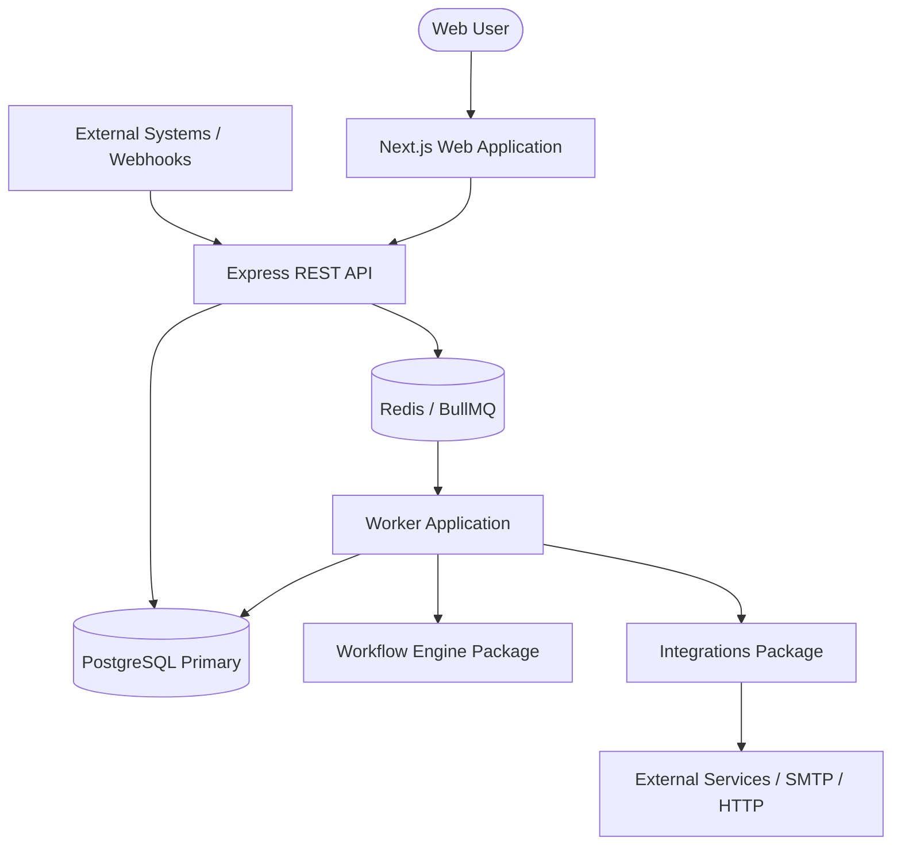
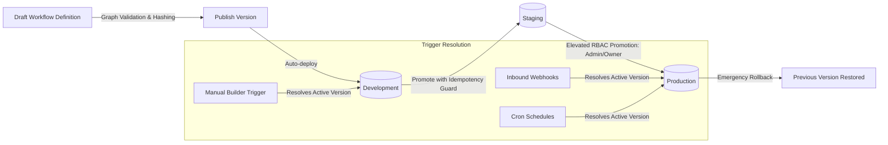
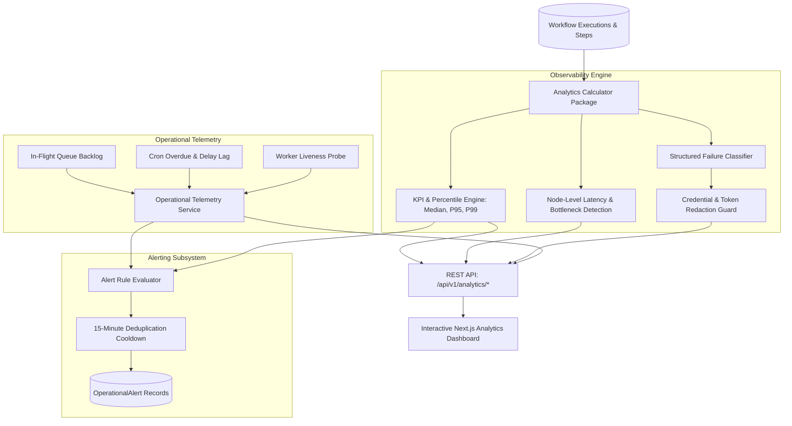
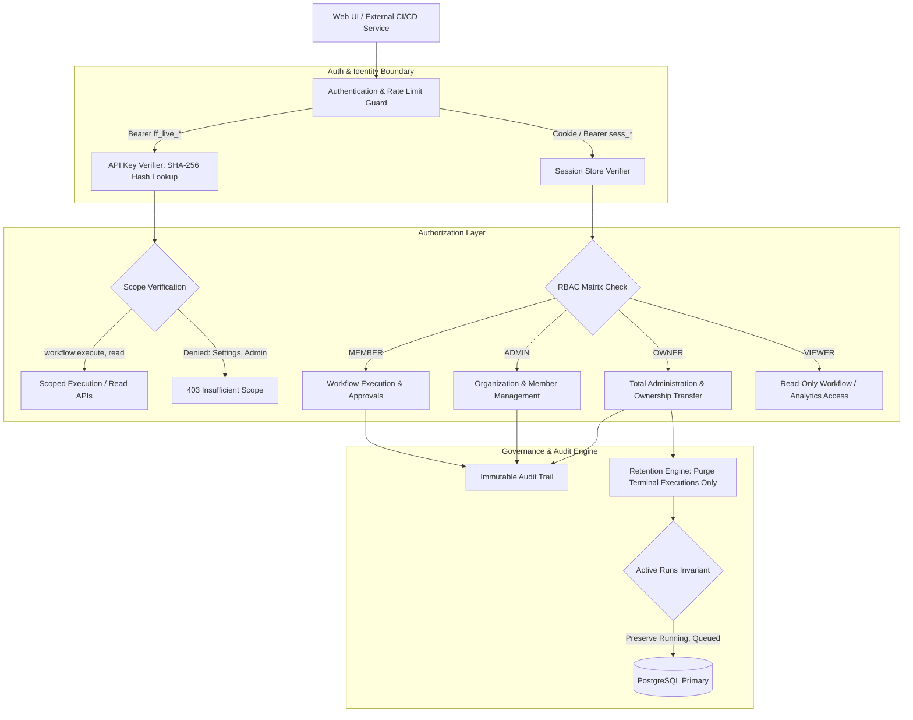
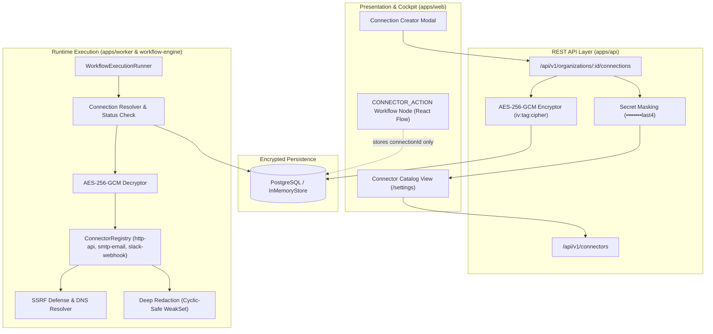
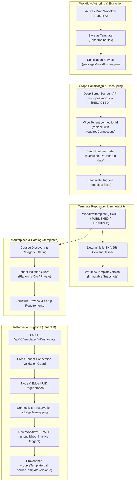
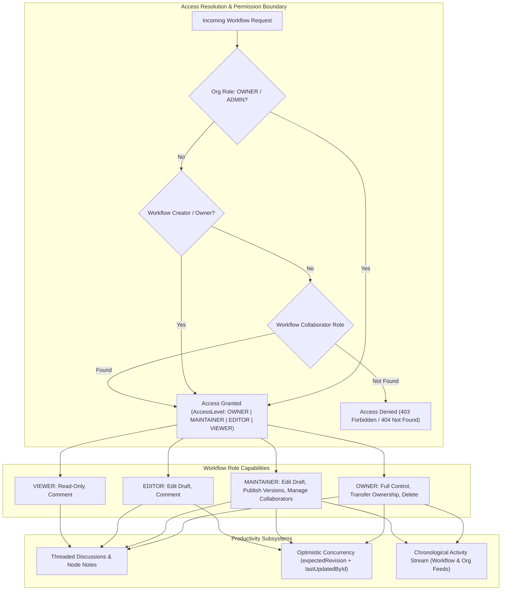
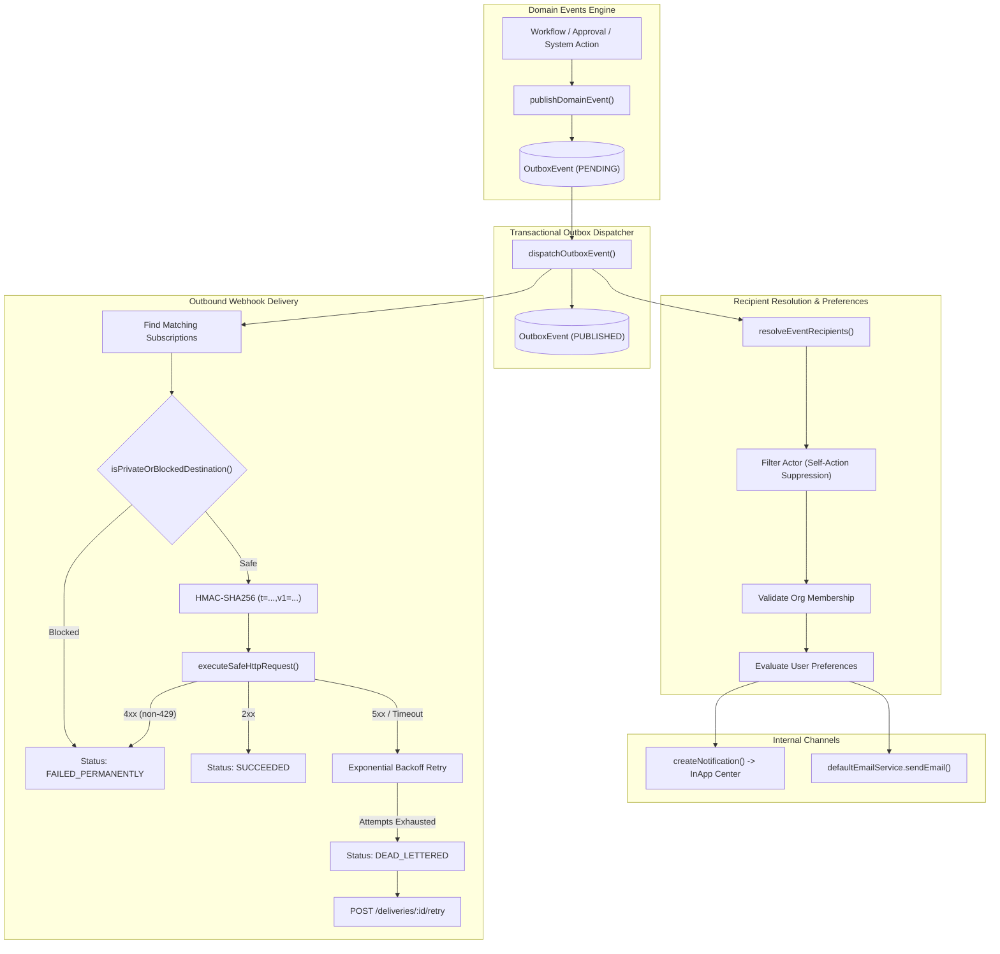
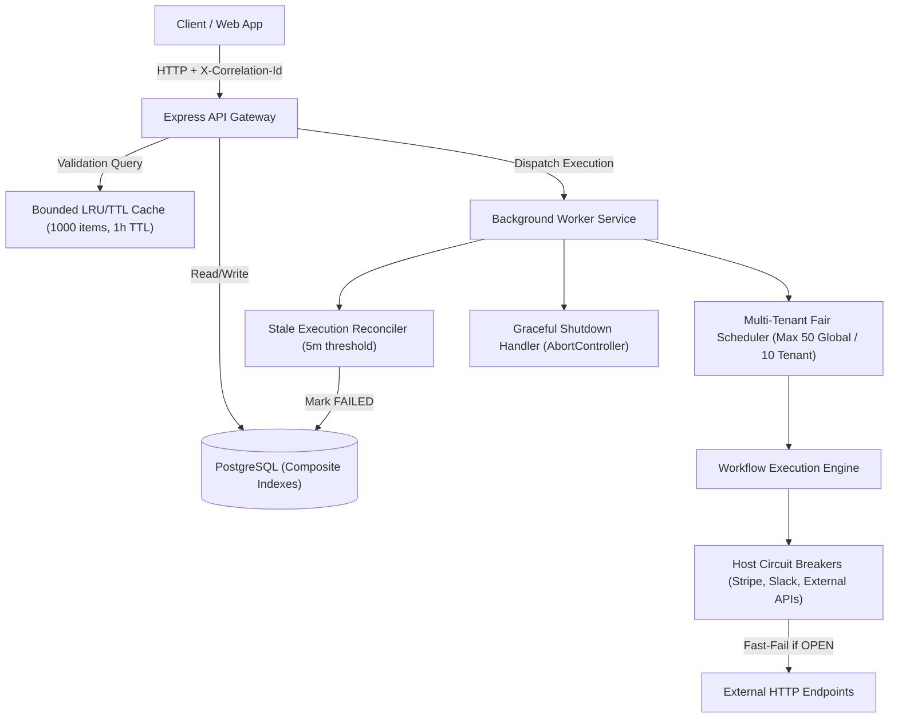

# FlowForge Architecture

## 1. System Overview

FlowForge is a resilient, multi-tenant business workflow automation platform built with modern TypeScript across both backend services and frontend applications.

## 2. Monorepo Structure & Boundaries

The codebase is structured as a pnpm monorepo with distinct separation of concerns:

- `apps/web`: Next.js frontend with Tailwind CSS and React Flow for visual workflow editing, execution monitoring, approval inbox, and dashboard.
- `apps/api`: Node.js Express API providing authenticated REST endpoints for workflows, versions, executions, approvals, credentials, and webhooks.
- `apps/worker`: BullMQ background worker executing discrete workflow tasks, handling retries, polling delays, and resilient state recovery.
- `packages/database`: Prisma schema, migrations, connection pooling, and multi-tenant repository abstractions.
- `packages/shared`: Universal domain types, Zod schemas, error definitions, and constants shared across client and server.
- `packages/workflow-engine`: Core pure engine logic (graph validation, topological sort, DAG cycle detection, condition evaluation, and execution state transitions). Has zero dependencies on HTTP or UI frameworks.
- `packages/integrations`: Connectors for Webhooks, outgoing HTTP requests, email notifications, and scheduled triggers with SSRF protections and timeout controls.
- `packages/config`: Common configuration, environment variable loaders, and logger definitions.
- `packages/test-utils`: Test fixtures, mock servers, and testing helpers.

## 3. Storage & Resilience Guarantees

- **PostgreSQL as Source of Truth**: All workflow definitions, immutable versions, executions, and step states are durably stored in PostgreSQL. Redis is strictly used as an execution transport and job queue; execution history never relies on Redis persistence.
- **Worker Recovery & Idempotency**: Jobs are assigned deterministic execution and step IDs. Worker crashes during step execution are detected by heartbeat timeouts and re-evaluated using idempotent step transitions.
- **Immutable Versions**: When a workflow is published, its definition snapshot is stored as an immutable `WorkflowVersion`. Running executions bind to a specific version and remain unaffected by subsequent workflow drafts.

## 4. Host Environment Audit & Fallbacks

- Host: Windows 10/11 x64, Node.js v24.19.0, npm 11.17.0, pnpm 12.16.1.
- Docker daemon is not running natively on this Windows workstation.
- Containerized configurations (`Dockerfile`, `docker-compose.yml`) are fully provided for standard containerized deployment.
- Local execution & test suites leverage Prisma with SQLite/PGlite or configurable PostgreSQL URL and simulated/in-memory queue fallbacks when external daemons are absent.

## 5. Workflow Engine Package Boundaries

`packages/workflow-engine` serves as the standalone core of FlowForge:

- **Zero Framework Coupling**: Operates independently of Next.js, Express, PostgreSQL, and BullMQ.
- **Pure Functional Core**: Graph validation (`validateWorkflowDefinition`), cycle detection (DFS with recursion stack), topological sorting (Kahn's algorithm with deterministic tie-breaking), and condition evaluation operate on pure in-memory data structures without network or database I/O.
- **Node Registry & Handler Contracts**: Defines strongly-typed handler interfaces (`NodeHandler`, `ExecutionContext`, `StepExecutionResult`) and metadata registries used by the API for validation and by the worker for step execution.

## 6. Workflow Lifecycle, Versioning & Multi-Environment Promotion Architecture

### 6.1 Canonical Content Hashing

To guarantee reproducible identity and detect true semantic modifications without false positives caused by UI canvas layout changes:

- `canonicalizeWorkflowDefinition`: Normalizes node orders by identifier, filters out transient UI layout coordinates (`position`), sorts node configuration keys alphabetically, and standardizes edge fields (`id`, `source`, `target`, `sourceHandle`, `targetHandle`).
- `computeWorkflowContentHash`: Produces a deterministic `SHA-256` hexadecimal digest of the canonical string representation.
- Prevents duplicate publishing when draft contents have not semantically changed (`409 UNCHANGED_CONTENT`).
- Re-verifies content integrity prior to environment promotion (`422 HASH_VERIFICATION_FAILED`).

### 6.2 Immutable Version Guarantee

- Published `WorkflowVersion` entities are strictly append-only.
- Direct mutations (`PUT`, `PATCH`, `DELETE`) on published versions are unconditionally rejected (`405 VERSION_IMMUTABLE`).
- Draft rollbacks / historical version restorations operate by copying the historical snapshot into the draft workspace (`draftRevision = currentRevision + 1`), preserving complete audit trails.

### 6.3 Multi-Environment Promotion & Rollback Mechanics

- Environments supported: `development`, `staging`, `production`.
- Deployments tracked via `WorkflowDeployment` with statuses `ACTIVE`, `SUPERSEDED`, and `ROLLED_BACK`.
- **Production Safeguards**: Non-admin members (`MEMBER`) are restricted from deploying or rolling back production (`403 PRODUCTION_DEPLOY_UNAUTHORIZED`); `ADMIN` and `OWNER` privileges are enforced.
- **Rollback Guarantee**: Restores traffic to a prior immutable version without deleting deployment logs or altering in-flight workflow executions. Running executions remain bound to the version snapshot recorded at trigger acceptance time.

## 7. Observability, Telemetry, Failure Analysis, and Operational Intelligence Architecture

FlowForge provides a native, multi-tenant analytics and operational intelligence subsystem built directly into the engine, API, and frontend:

### 7.1 Statistical Aggregation & Percentile Precision

- **Half-Open Time Boundaries**: Queries use `[from, to)` intervals, guaranteeing that metric queries across contiguous windows neither omit nor double-count executions.
- **Percentile Calculation**: Uses linear interpolation across sorted duration arrays of completed executions, accurately representing `medianMs` (P50), `p95Ms`, and `p99Ms` without sampling bias.
- **Retry Invariants**: Retries are tracked as execution iterations (`retryCount`) and do not inflate root execution counts or skew success rates.
- **Comparison Windows**: Computes automatic period-over-period comparisons against prior equivalent windows for execution volume and success rate deltas.

### 7.2 Graph Bottleneck Identification

- Evaluates individual node execution duration and error distributions across workflow execution steps.
- Flags nodes as bottlenecks when their average step duration exceeds 40% of overall workflow runtime or when failure rates deviate significantly from baseline.

### 7.3 Structured Failure Classification & Security Redaction

- Evaluates unstructured error details, status codes, and node contexts into discrete domain failure categories:
  - `VALIDATION_ERROR`, `AUTH_ERROR`, `INTEGRATION_ERROR`, `HTTP_TIMEOUT`, `SERVICE_ERROR`, `RATE_LIMITED`, `NODE_CONFIG_ERROR`, `RUNTIME_ERROR`, `QUEUE_ERROR`, `CANCELLATION`, `UNKNOWN_ERROR`.
- **Zero-Leakage Sanitization**: Before persistence or serialization over the analytics API, all raw error strings are filtered through `sanitizeErrorMessage`, which strips passwords, secrets, Bearer tokens, and JWT strings (`[REDACTED]`).

### 7.4 Operational Alerts & 15-Minute Cooldown Deduplication

- Rules evaluate high failure rates (>= 25% failure over last hour with >= 4 executions), consecutive workflow failures (>= 3 failures), queue backlog thresholds (> 15 queued executions), and scheduler lag (> 2 minutes overdue).
- Enforces an automated 15-minute cooldown per rule and entity (`${orgId}_${ruleType}_${target}`) preventing notification flooding during sustained outages.
- Provides manual resolution workflow (`POST /alerts/:id/resolve`) requiring `analytics:write` with mandatory audit trail capture.

## 8. Enterprise Security, Governance, and Audit Trail Architecture

### 8.1 Dual Authentication & Credential Boundaries

1. **User Sessions**: Issue HTTP-only, secure cookies or session bearer tokens for human interactive web use. Map to explicit role tiers (`OWNER`, `ADMIN`, `MEMBER`, `VIEWER`).
2. **Programmatic API Keys**: Formatted as `ff_live_<hex32>`. Plaintext tokens are returned strictly once at generation time. Only a SHA-256 `keyHash` and 16-character `keyPrefix` are persisted in the database.
3. **Scope Enforcements**: API keys carry granular authorization scopes (`workflow:read`, `workflow:execute`, `workflow:write`, `analytics:read`, `audit:read`). Programmatic keys are strictly forbidden from performing identity management, ownership transfer, or session escalation.

### 8.2 Role-Based Access Control (RBAC) Matrix

| Resource / Operation                       | Owner |       Admin        | Member | Viewer |
| :----------------------------------------- | :---: | :----------------: | :----: | :----: |
| **Transfer Ownership**                     |  Yes  |         No         |   No   |   No   |
| **Organization Settings & Retention**      |  Yes  | Yes (No Retention) |   No   |   No   |
| **Member Administration & Roles**          |  Yes  |  Yes (Non-Owner)   |   No   |   No   |
| **Issue & Revoke Invitations**             |  Yes  |  Yes (Non-Owner)   |   No   |   No   |
| **Generate & Revoke API Keys**             |  Yes  |        Yes         |   No   |   No   |
| **Create & Publish Workflows**             |  Yes  |        Yes         |   No   |   No   |
| **Promote to Production**                  |  Yes  |        Yes         |   No   |   No   |
| **Execute Workflows & Decisions**          |  Yes  |        Yes         |  Yes   |   No   |
| **Read Workflows, Executions & Analytics** |  Yes  |        Yes         |  Yes   |  Yes   |

### 8.3 Invariant Guarantees

- **Last-Owner Protection**: An organization must never become ownerless. System enforces server-side guards preventing demoting, deleting, or self-leaving the sole owner.
- **Single-Use Cryptographic Invitations**: Invitation tokens are hashed with SHA-256 before storage. Acceptance is atomic and single-use; tokens expire after 7 days and can be revoked on-demand.
- **Active State Data Retention Invariant**: Retention policies strictly purge completed terminal runs (`SUCCEEDED`, `FAILED`, `CANCELLED`). Running, queued, or paused workflows (`RUNNING`, `QUEUED`, `WAITING_APPROVAL`, `WAITING_DELAY`, `RETRYING`) are permanently shielded from deletion.
- **Sanitized Audit Trail**: All administrative and lifecycle mutations emit structured audit events. Raw passwords, bearer tokens, API key secrets, and invitation secrets are unconditionally excluded.

---

## 9. Connector Registry, Integration Architecture, and Credential Security

### 9.1 Separation of Concerns: Connectors vs Connections

- **Connector (`ConnectorDefinition`)**: A stateless, typed blueprint defining capabilities, supported operations, input/output schemas, and authentication configuration. Connectors are globally registered in `defaultConnectorRegistry` (`http-api`, `smtp-email`, `slack-webhook`).
- **Connection (`IntegrationConnection`)**: An organization-scoped, configured instance holding authenticated credentials, status (`ACTIVE`, `DISABLED`, `REVOKED`), and health diagnostics. Workflows reference connections strictly by ID; plaintext credentials are never embedded in workflow definitions.

### 9.2 Cryptographic Security & Credential Lifecycle

1. **AES-256-GCM Encryption at Rest**: All credential payloads (`apiKey`, `password`, `token`, `webhookUrl`) are encrypted using authenticated AES-256-GCM with unique 16-byte initialization vectors. Stored format: `iv:authTag:ciphertext`.
2. **Zero Plaintext Leakage**: Responses returned across the REST API unconditionally omit plaintext secrets. Only masked summaries (`••••••••last4` or `••••••••`) are displayed in the administration UI.
3. **Deep Recursive Redaction**: All log messages, response payloads, headers, query parameters, and error traces pass through `redactDeep`. Handles arbitrary structures and cyclic object graphs safely using `WeakSet`.
4. **Server-Side SSRF Defenses**: Outbound connector requests are validated by `resolveAndValidateDestination` against loopback addresses (`127.0.0.1`), RFC 1918 private subnets (`10.0.0.0/8`, `172.16.0.0/12`, `192.168.0.0/16`), and cloud link-local metadata endpoints (`169.254.169.254`). Non-HTTP protocols and private redirect destinations are blocked.
5. **Non-Idempotent Retry Guards**: Workflow execution runner classifies connector failures; operations that are non-idempotent (`idempotentRetry: false`) fail permanently without retrying, preventing duplicate external charges or messaging.

---

## 10. Workflow Templates, Reusable Components, and Template Marketplace

### 10.1 Template Lifecycle & Separation of Concerns

1. **Templates as Reusable Blueprints**: A template defines the topological structure, node configurations, and integration contracts of a business process without binding to specific organizational credentials or live runtime executions.
2. **Deep Graph Sanitization**: When saving a workflow as a template (`sanitizeWorkflowForTemplate`), all raw credentials, API tokens, webhook URLs, and authorization headers are scrubbed to `"[REDACTED]"`. Specific `connectionId` values are cleared and transformed into abstract `requiredConnections` requirements (`slack-webhook`, `smtp-email`, `http-api`). Runtime execution artifacts (`executionId`, `lastOutput`) are stripped, and trigger nodes are set to `enabled: false`.
3. **Immutable Content-Hashed Versions**: Published template versions (`WorkflowTemplateVersion`) store exact graph snapshots with monotonic version numbers and deterministic SHA-256 digests (`computeWorkflowContentHash`). Versions are immutable; subsequent edits modify the template's editable draft definition until published.
4. **Deterministic Node & Edge UUID Regeneration**: Instantiation (`instantiateGraphFromTemplate`) never copies raw node IDs. It generates fresh UUIDs for every node and edge (`node_<type>_<uuid>`, `edge_<uuid>`) and updates all edge `source` and `target` handles. This guarantees zero ID collisions with the template or existing organization workflows while preserving graph connectivity.
5. **Safe Defaults on Instantiation**: Instantiated workflows are created with `status: "DRAFT"` and `publishedVersionId: undefined`. Triggers remain disabled (`enabled: false`) to ensure workflows never execute automatically until explicitly published and verified by an authorized user in the target organization.
6. **Multi-Tenant Isolation & Anti-Hijacking Invariants**:
   - `PLATFORM` templates are discoverable and instantiable across all tenants.
   - `ORGANIZATION` templates are restricted strictly to authenticated members of the owning organization.
   - `PRIVATE` templates are visible only to their creator.
   - Cross-tenant template requests return 404/403.
   - Callers cannot bind connection IDs belonging to other organizations; cross-tenant connection references during instantiation are strictly rejected with 403 `CROSS_TENANT_CONNECTION_FORBIDDEN`.
7. **Provenance Tracking**: Instantiated workflows retain permanent references to their origin (`sourceTemplateId` and `sourceTemplateVersionId`), enabling organization-wide auditability, lineage tracking, and template usage metrics.

## 11. Workflow Collaboration, Access Roles, and Productivity Architecture

### 11.1 Access Resolution Layer

1. **Hierarchical Authority**: Organization `OWNER` and `ADMIN` retain superuser authority across all workflows within their organization, allowing enterprise governance without individual collaborator assignments.
2. **Workflow Primary Ownership**: The workflow creator (`createdById`) possesses full operational rights. When primary ownership is transferred (`POST /api/v1/workflows/:id/transfer-ownership`), the previous owner is automatically added to the collaborator registry as a `MAINTAINER` to prevent accidental lockout.
3. **Collaborator Scopes**:
   - `MAINTAINER`: Can modify drafts, publish workflow versions, and add/remove collaborators.
   - `EDITOR`: Can update drafts and participate in discussions; cannot publish or manage collaborators.
   - `VIEWER`: Can inspect graph structure and post feedback comments; blocked from updating drafts.
4. **Tenant Enclosure**: Collaborators must be active members of the same organization. Cross-tenant user additions are rejected with 400 `INVALID_COLLABORATOR`, and cross-tenant resource queries return 404/403.

### 11.2 Contextual Discussions and Node Pinning

1. **Threaded Discussions**: Comments support optional parent references (`parentId`), creating hierarchical reply trees returned with author profiles.
2. **Graph Pinning**: Comments can attach to specific node IDs (`nodeId`) and pin to the draft revision (`draftRevision`) at the time of authoring, ensuring reviewers can trace comments back to the exact graph configuration.
3. **State Tracking**: Comments feature resolution toggles (`isResolved: boolean`) with resolver attribution (`resolvedById`) and filtering (`status: open | resolved | all`).
4. **Author Protection**: Only the comment author or an Organization Admin/Owner can edit or delete a comment thread.

### 11.3 Concurrency & Change Attribution

1. **Optimistic Concurrency Control**: Draft saves accept `expectedRevision`. If another collaborator saves an update concurrently, the conflicting save is rejected with a 409 `DRAFT_CONFLICT` containing `currentRevision`, `expectedRevision`, and `lastUpdatedById`.
2. **Chronological Activity Feeds**: All lifecycle and collaboration events (`WORKFLOW_CREATED`, `DRAFT_UPDATED`, `WORKFLOW_PUBLISHED`, `OWNERSHIP_TRANSFERRED`, `COLLABORATOR_ADDED`, `COLLABORATOR_REMOVED`, `COLLABORATOR_ROLE_UPDATED`, `COMMENT_ADDED`, `COMMENT_RESOLVED`, `COMMENT_DELETED`) are durably recorded in `WorkflowActivity` and surfaced at both workflow and organization levels.

---

## 12. Notification & Event Delivery Architecture

### 12.1 Canonical Event Contract

- All platform actions emit strongly-typed canonical events conforming to `FlowForgeEventSchema` (`v1.0`).
- Every event carries a UUID `id`, `type`, `organizationId`, `actorId`, `resourceType`, `resourceId`, ISO `createdAt`, and a distributed tracing `correlationId`.
- Stable types include `workflow.execution.*`, `approval.*`, `workflow.published`, `workflow.collaborator_*`, and `workflow.ownership_transferred`.

### 12.2 Transactional Outbox Pattern

- Events are written synchronously to `outbox_events` within the originating transaction with `status: PENDING`.
- An asynchronous dispatcher (`dispatchOutboxEvent`) reads pending outbox entries, resolves recipients, fans out internal notifications and outbound webhooks, and transitions the outbox entry to `status: PUBLISHED` with `publishedAt`.
- This ensures at-least-once delivery semantics without holding open web request transactions or dropping notifications on worker failure.

### 12.3 Recipient Resolution & Self-Action Suppression

- Rules deterministically map event types to user roles:
  - `workflow.execution.failed`: Resolves workflow owner, collaborators (`MAINTAINER`, `EDITOR`), and organization administrators.
  - `approval.requested`: Resolves assigned approver, or broadcasts to organization admins if unassigned.
  - `workflow.collaborator_added`: Resolves targeted collaborator.
- **Self-Action Suppression**: The user who triggered the event (`actorId`) is excluded from recipient lists to prevent self-notification spam.
- **Multi-Tenant Boundary**: All resolved recipients are validated against organization memberships (`OrganizationMember`), preventing cross-tenant information disclosure.

### 12.4 Secure Outbound Webhooks & SSRF Defense

- **SSRF Defense**: Subscriptions and deliveries validate destinations using `isPrivateOrBlockedDestination` and deep DNS checks, blocking loopback (`127.0.0.1`, `localhost`), link-local (`169.254.169.254`), private RFC1918 subnets, and non-HTTP(S) schemes. Blocked attempts fail immediately without retry.
- **HMAC Signatures**: Every outbound request carries `X-FlowForge-Signature: t=${timestamp},v1=${signature}`, computed via HMAC-SHA256 over `${timestamp}.${rawJsonPayload}`.
- **Secret Lifecycle**: Webhook secrets are prefixed with `whsec_`, masked in all list/read endpoints, and support zero-downtime rotation via `POST /subscriptions/:id/rotate-secret`.
- **Delivery State Machine**: Tracks status (`PENDING` -> `PROCESSING` -> `SUCCEEDED` / `FAILED_PERMANENTLY` / `RETRY_SCHEDULED` / `DEAD_LETTERED`). Retries use bounded exponential backoff with jitter up to 5 attempts, with manual replay support via `POST /deliveries/:id/retry`.

---

## 13. Workflow Import, Export, Portability, and Backup/Restore Architecture

### 13.1 Package Design & Deterministic Integrity Hashing

The FlowForge portability specification (`flowforge.package/v1`) standardizes workflow interchange across tenants and environments without leaking infrastructure details or runtime state.

1. **Deterministic Canonical Hashing**:
   - The SHA-256 package hash is computed by recursively sorting all dictionary keys in canonical order (`canonicalizeJson`) across the definition, metadata, and dependencies before feeding UTF-8 bytes to `crypto.createHash("sha256")`.
   - Any manual or hostile modification to graph structure, node configs, metadata, or dependency declarations immediately invalidates the hash.
   - Verification uses constant-time comparison (`crypto.timingSafeEqual`) to mitigate side-channel timing attacks.

2. **Secret Scrubbing & Abstraction Boundary**:
   - `deepScrubSecrets` traverses all configuration objects, redacting authorization headers, bearer tokens, API keys, passwords, and webhook secrets.
   - Tenant database connection UUIDs are abstracted into portable connection references (`conn_ref_1`, `conn_ref_2`), ensuring zero leakage of database identifiers or credentials across organization boundaries.
   - Execution artifacts (`executionId`, `lastRun`, `runCount`, `testResult`) are purged.
   - Trigger configurations have their `enabled` and `active` flags forced to `false`, preventing accidental automated execution upon import.

### 13.2 Multi-Tenant Isolation & Mapping Enforcement

When importing a workflow package:

- Target connector mappings (`connectorMappings: { conn_ref_1: "conn_dest_uuid" }`) are strictly evaluated against the destination organization's active connection inventory.
- Cross-tenant mapping is blocked with a 403 `CROSS_TENANT_MAPPING_FORBIDDEN` response.
- Inactive or revoked connections are rejected with a 400 `INACTIVE_CONNECTION` error.
- Conflict strategies guarantee safe coexistence:
  - `CREATE_NEW`: Auto-resolves name collisions with an incremented suffix (`... (Imported 1)`).
  - `RENAME`: Customizes workflow title cleanly.
  - `REPLACE_DRAFT`: Updates only the mutable draft definition and increments `draftRevision`, leaving published immutable historical versions strictly untouched.

### 13.3 Provenance & Audit Ledger

Every import generates a permanent `WorkflowImport` record in the database tracking:

- `sourceWorkflowId`, `sourceRevision`, and originating package format version.
- Cryptographic `packageHash`.
- Destination `workflowId`, `conflictStrategy`, applied `connectorMappings`, and `importedById`.
- Audit logs (`workflow.exported`, `workflow.imported`) and workflow activity entries (`WORKFLOW_CREATED` / `DRAFT_UPDATED`) are recorded synchronously.

---

## 14. Performance, Scalability, Reliability, and Production Hardening Architecture

### 14.1 Empirical Baselines & SLO Enforcement

All system components enforce strict latency and throughput budgets measured across 11 critical operational workloads:

- **API Reads (`GET /workflows`, `GET /executions`, `GET /analytics`)**: p95 $\le 15$ms; p99 $\le 50$ms.
- **API Mutations (`POST /execute`, `POST /publish`, `PATCH /workflows/:id`)**: p95 $\le 20$ms; p99 $\le 50$ms.
- **Workflow Graph Validation**: p95 $\le 0.1$ms uncached; $\le 0.02$ms cached (>100,000 ops/s).
- **Step Execution**: p95 $\le 0.1$ms for pure functional transitions.
- **Availability SLO**: 99.9% uptime over rolling 30-day windows ($\le 43.8$ minutes downtime/month).
- **Error Budget Multi-Burn-Rate Alerting**: 1h burn rate > 14.4 (Page); 6h burn rate > 6.0 (P2); 36h burn rate > 1.0 (Ticket).

### 14.2 Database Composite Indexing

Composite indexes are deployed in PostgreSQL to maintain logarithmic search times at scale:

- `Workflow([organizationId, status])` and `Workflow([organizationId, updatedAt])`
- `WorkflowExecution([organizationId, status])`, `WorkflowExecution([workflowId, status])`, and `WorkflowExecution([organizationId, createdAt])`
- `ExecutionStep([executionId, status])` and `ExecutionStep([executionId, startedAt])`
- `AuditLog([organizationId, createdAt])` and `OutboxEvent([status, createdAt])`

### 14.3 Bounded LRU/TTL Validation Caching

- Keyed by deterministic SHA-256 hash of the normalized workflow definition (`computeWorkflowContentHash`).
- Prevents redundant DFS cycle detection and schema traversal on high-frequency validation calls.
- Configured with bounded capacity (1,000 entries) and 1-hour TTL to guard memory boundaries.

### 14.4 Multi-Tenant Fair Scheduling & Execution Concurrency Bounds

- **Global Concurrency Ceiling**: 50 concurrent active executions per worker instance.
- **Tenant Quota Guarantee**: 10 concurrent active executions per organization.
- **Fair Scheduling**: Busy tenants hitting their limit receive early admission rejection without degrading throughput for neighboring organizations.
- **Graceful Shutdown**: Traps shutdown signals and aborts in-flight execution pipelines via `AbortController` without leaving dangling socket descriptors.

### 14.5 External Dependency Resilience & Circuit Breakers

- Outbound HTTP requests to external partner endpoints are governed by host-keyed circuit breakers (`defaultCircuitBreakerRegistry`).
- State machine:
  - 5 consecutive network or timeout failures trip breaker from `CLOSED` to `OPEN`.
  - In `OPEN` state, calls fast-fail immediately (`CircuitBreakerError`) without socket allocation.
  - After a 30-second cooldown, breaker transitions to `HALF_OPEN` for 1 probe attempt before resetting or tripping.
- Retries apply exponential backoff with full jitter ($200 \times 2^{\text{attempt}} \times [0.8, 1.2]$).

### 14.6 Stale Execution Recovery & RTO/RPO

- Executions stranded in `RUNNING` for $\ge 300$ seconds (e.g. following sudden worker node termination) are detected and reconciled by `recoverStaleExecutions`.
- In-flight running steps are reconciled to `FAILED`, and the execution error details record `staleDurationMs`.
- **RTO**: $\le 5$ minutes automated recovery.
- **RPO**: 0 seconds for all committed state through transactional outbox and Prisma operations.

### 14.7 Distributed Tracing & Observability

- All API requests carry or generate an `X-Correlation-Id` passed through execution logs and event payloads.
- Kubernetes endpoints:
  - `/health` & `/health/live`: Process liveness probe.
  - `/ready` & `/health/ready`: Dependency readiness probe (verifies database store readiness).
  - `/health/metrics` & `/api/v1/metrics`: Diagnostic runtime metrics exposing memory heap, process uptime, validation cache statistics, and circuit breaker states.
