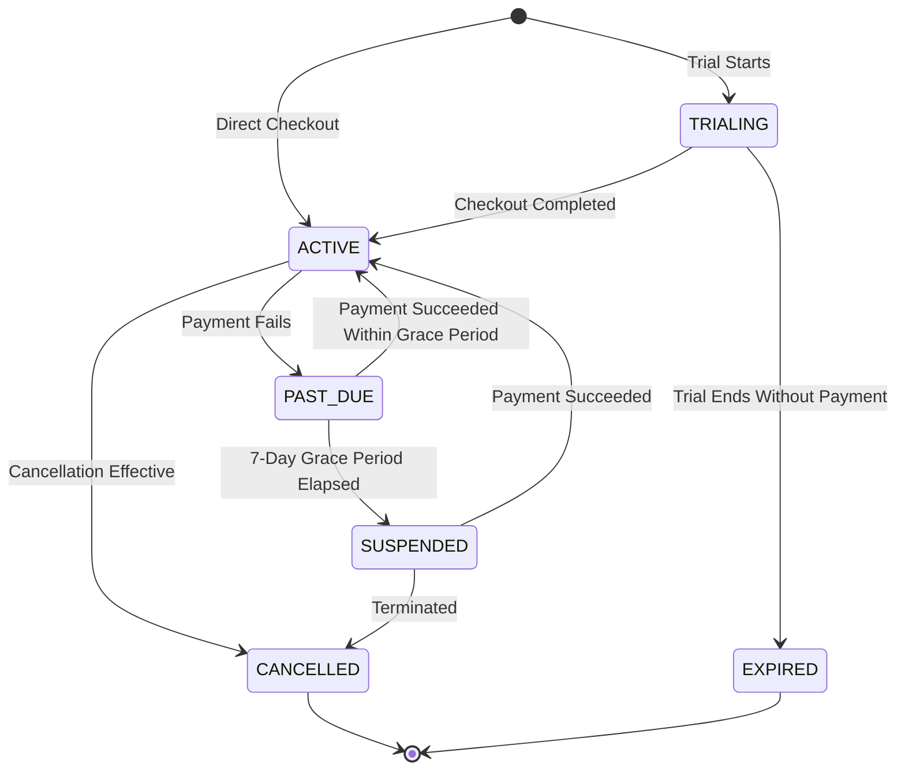

# FlowForge — Enterprise SaaS Billing, Subscription Management, and Usage Metering Architecture

**Version:** 1.0.0  
**Status:** Approved Architecture & Implementation  
**Audience:** FlowForge Platform Engineers, SREs, Product Operations, and Billing Administrators

---

## 1. Overview & Business Model

FlowForge operates as a multi-tenant enterprise workflow automation SaaS platform. The commercial layer provides flexible subscription plans, hard and soft entitlement gating, durable usage metering, payment provider integration (Stripe and sandbox/mock adapter), invoice history, delinquency management, and self-service customer portal integration.

### Core Guiding Principles

1. **Never Drop Existing Workflows on Downgrade**: If an organization downgrades to a plan with lower resource limits, existing workflows, connectors, and history are preserved. New allocations are blocked until usage drops within the new plan limits.
2. **Server-Side Authority**: All entitlement checks and quota enforcements occur on the backend API. Frontend indicators exist purely for user feedback and are never trusted as security boundaries.
3. **Transactional & Durable Metering**: Metering events are tracked durably with idempotency keys to prevent duplicate billing during execution retries or repeated webhook deliveries.
4. **Grace Periods Over Abrupt Disruptions**: Failed subscription renewals enter a 7-day grace period with active notifications before transitioning to suspended status.

---

## 2. Subscription Plans & Entitlements Catalog

FlowForge defines four standard tiers configurable in `@flowforge/shared` and persisted in the database:

| Feature / Limit                                       | Free Tier (`plan_free`) | Starter Tier (`plan_starter`) | Pro Tier (`plan_pro`)     | Enterprise Tier (`plan_enterprise`) |
| :---------------------------------------------------- | :---------------------- | :---------------------------- | :------------------------ | :---------------------------------- |
| **Monthly Price (USD)**                               | $0 / month              | $29 / month ($290 / year)     | $99 / month ($990 / year) | $299 / month ($2,990 / year)        |
| **Trial Period**                                      | None                    | 14 Days                       | 14 Days                   | 30 Days                             |
| **Seat Limit (`maxSeats`)**                           | 50 (Community)          | 5                             | 20                        | **Unlimited (-1)**                  |
| **Total Workflows (`maxWorkflows`)**                  | 100                     | 25                            | 100                       | **Unlimited (-1)**                  |
| **Active Workflows (`maxActiveWorkflows`)**           | 50                      | 10                            | 50                        | **Unlimited (-1)**                  |
| **Monthly Executions (`maxMonthlyExecutions`)**       | 10,000                  | 5,000                         | 50,000                    | 500,000                             |
| **Concurrent Executions (`maxConcurrentExecutions`)** | 50                      | 5                             | 15                        | 50                                  |
| **Connectors (`maxConnectors`)**                      | 50                      | 5                             | 20                        | **Unlimited (-1)**                  |
| **Audit & Log Retention**                             | 30 Days                 | 30 Days                       | 90 Days                   | 365 Days                            |
| **Analytics Dashboard**                               | Included                | Included                      | Included (Advanced)       | Included (Advanced)                 |
| **Enterprise Governance**                             | Included                | Standard                      | Included                  | Included                            |
| **Custom Connectors**                                 | Included                | Standard                      | Included                  | Included                            |
| **Single Sign-On (SAML/SSO)**                         | No                      | No                            | No                        | **Yes**                             |
| **Dedicated Support SLA**                             | Community               | Email                         | Priority                  | 24/7 Dedicated                      |

---

## 3. Subscription Lifecycle & State Machine



### Lifecycle States

1. `TRIALING`: Customer is evaluating a paid plan during the trial window. All plan entitlements are available.
2. `ACTIVE`: Subscription is current and payments are in good standing.
3. `PAST_DUE`: A renewal payment has failed. A 7-day grace period is initiated (`gracePeriodEnd = now + 7d`). Workflows continue running; urgent notifications are dispatched to billing admins.
4. `SUSPENDED`: The 7-day grace period has elapsed without a successful charge. New workflow executions are rejected with `402 Payment Required` (`SUBSCRIPTION_SUSPENDED`). Existing workflows and execution histories remain intact.
5. `CANCELLED`: Subscription has reached the end of the billing period after cancellation was requested (`cancelAtPeriodEnd: true`). Reverts to Free plan limits.
6. `EXPIRED`: Trial elapsed without payment method attachment.

---

## 4. Centralized Entitlement Service (`EntitlementService`)

All subscription and quota decisions are evaluated centrally via `EntitlementService`:

### Backend Gating Hooks

- **Workflow Execution Dispatch** (`POST /api/v1/workflows/:id/execute`):
  - Checks if subscription is `SUSPENDED` -> Returns `402 SUBSCRIPTION_SUSPENDED`.
  - Checks concurrent executions running (`status === "RUNNING"`) -> Returns `429 CONCURRENT_EXECUTION_LIMIT_EXCEEDED`.
  - Checks monthly execution quota against billing period -> Returns `402 QUOTA_EXCEEDED`.
  - On acceptance, records a durable `UsageRecord` with `idempotencyKey: execution.id`.
- **Workflow Creation** (`POST /api/v1/workflows`):
  - Checks `workflows.length < maxWorkflows` -> Returns `402 QUOTA_EXCEEDED`.
- **Workflow Publishing** (`POST /api/v1/workflows/:id/publish`):
  - If transitioning from draft to active, checks `activeWorkflows < maxActiveWorkflows` -> Returns `402 QUOTA_EXCEEDED`.
- **Member Invitations** (`POST /api/v1/organizations/:id/invitations`):
  - Checks `memberships.length + 1 <= maxSeats` -> Returns `402 QUOTA_EXCEEDED`.
- **Connector Connections** (`POST /api/v1/connectors`):
  - Checks `connections.length < maxConnectors` -> Returns `402 QUOTA_EXCEEDED`.

---

## 5. Durable Usage Metering & Concurrency Safety

### Metering Dimensions

1. `WORKFLOW_EXECUTION`: Counter incremented whenever an execution is queued.
2. `CONNECTOR_INVOCATION`: Counter incremented when an external connector step executes.
3. `SEATS`: Gauge derived from active organization memberships.
4. `ACTIVE_WORKFLOWS`: Gauge derived from published active workflows.

### Idempotency & Deduplication

- Every `UsageRecord` requires an `organizationId`, `metric`, and optional `idempotencyKey`.
- A database constraint `@@unique([organizationId, metric, idempotencyKey])` guarantees that network retries or multiple worker attempts cannot double-meter an execution.

### Concurrency Safety

- In-flight concurrent executions are counted dynamically against active database states.
- Worker tasks hold short-lived heartbeat leases (60s). When workers crash, leases expire and resources are automatically reclaimed.

---

## 6. Payment Provider Adapter & Webhook Security

FlowForge abstracts payment operations through `BillingProviderAdapter`:

```typescript
export interface BillingProviderAdapter {
  createCheckoutSession(
    params: CreateCheckoutParams,
  ): Promise<CheckoutSessionResult>;
  createPortalSession(params: CreatePortalParams): Promise<PortalSessionResult>;
  getSubscription(
    providerSubId: string,
  ): Promise<ProviderSubscriptionDetails | null>;
  cancelSubscription(
    providerSubId: string,
    atPeriodEnd: boolean,
  ): Promise<boolean>;
  verifyWebhookSignature(
    payload: string | Buffer,
    signature: string,
    secret: string,
  ): boolean;
  reconcileSubscription(
    subscription: SubscriptionRecord,
  ): Promise<ReconciliationResult>;
}
```

### Webhook Signature Verification

- Inbound webhooks sent to `POST /api/v1/billing/webhook` are authenticated via HMAC-SHA256 signatures (`stripe-signature` or `x-billing-signature`).
- Signatures include timestamp and payload hashes (`t=<timestamp>,v1=<hash>`) to prevent replay attacks.
- Invalid or expired signatures are immediately rejected with `401 Unauthorized`.

### Webhook Deduplication

- Webhook events are tracked in `BillingWebhookEvent` by `(provider, providerEventId)`.
- Duplicate deliveries of the same event ID return `200 OK` with `{ duplicate: true }` without re-executing state mutations.

---

## 7. Invoices & Billing History

- Paid invoices are synchronized into `InvoiceRecord` upon receipt of `invoice.payment_succeeded`.
- Stored attributes include `invoiceNumber`, `subtotal`, `tax`, `total`, `currency`, `amountPaid`, `hostedInvoiceUrl`, and `invoicePdfUrl`.
- **Tenant Isolation**: Invoices are strictly partitioned by `organizationId`. Cross-tenant requests (`GET /api/v1/billing/invoices/:id`) return `404 Not Found`.

---

## 8. Usage Visibility & Threshold Notifications

Organizations can view their usage and quota headroom via `GET /api/v1/billing/usage`.

### Automatic Notifications

- **80% Threshold**: When monthly executions reach 80% of quota, a high-priority warning notification is posted to the organization's Notification Inbox.
- **100% Threshold**: When monthly executions reach 100%, an urgent notification is emitted indicating that workflow triggers are paused until upgrade or billing period rollover.

---

## 9. Security, Data Privacy & PCI Compliance Boundaries

1. **Zero Raw Card Data**: FlowForge never receives, processes, or stores raw credit card numbers, CVVs, or cardholder credentials. All payment collection occurs on provider-hosted pages (Stripe Checkout / Customer Portal).
2. **Secrets Storage**: Webhook secrets and payment API keys are maintained as environment variables on the backend and are never exposed to the frontend.
3. **Audit Trail**: Every checkout session, plan upgrade, cancellation request, webhook failure, and reconciliation is recorded in the immutable audit log (`AuditLog`).
4. **Data Retention**: Subscription and invoice history is retained for 7 years to meet statutory commercial and tax accounting requirements.
