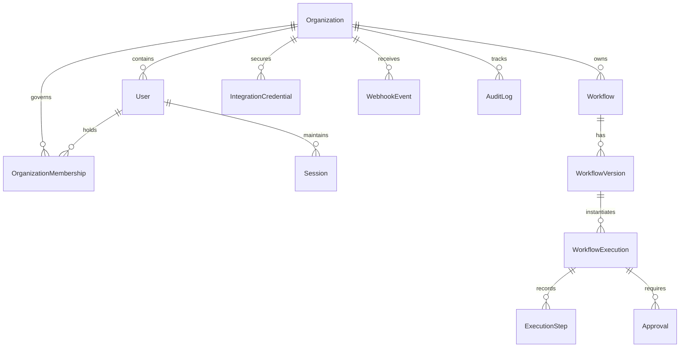

# FlowForge Database Schema Specification

## 1. Relational Entity Diagram

## 2. Core Tables & Field Definitions

### `organizations`
- `id`: UUID (PK)
- `name`: VARCHAR(255) NOT NULL
- `slug`: VARCHAR(255) UNIQUE NOT NULL
- `createdAt`: TIMESTAMPTZ NOT NULL DEFAULT NOW()
- `updatedAt`: TIMESTAMPTZ NOT NULL DEFAULT NOW()

### `users`
- `id`: UUID (PK)
- `email`: VARCHAR(255) UNIQUE NOT NULL
- `passwordHash`: VARCHAR(255) NOT NULL
- `firstName`: VARCHAR(100)
- `lastName`: VARCHAR(100)
- `createdAt`: TIMESTAMPTZ NOT NULL DEFAULT NOW()
- `updatedAt`: TIMESTAMPTZ NOT NULL DEFAULT NOW()

### `organization_memberships`
- `id`: UUID (PK)
- `organizationId`: UUID REFERENCES organizations(id) ON DELETE CASCADE
- `userId`: UUID REFERENCES users(id) ON DELETE CASCADE
- `role`: ENUM ('OWNER', 'ADMIN', 'MEMBER') NOT NULL DEFAULT 'MEMBER'
- `createdAt`: TIMESTAMPTZ NOT NULL DEFAULT NOW()
- UNIQUE (organizationId, userId)

### `sessions`
- `id`: UUID (PK)
- `userId`: UUID REFERENCES users(id) ON DELETE CASCADE
- `token`: VARCHAR(255) UNIQUE NOT NULL
- `ipAddress`: VARCHAR(45)
- `userAgent`: TEXT
- `expiresAt`: TIMESTAMPTZ NOT NULL
- `createdAt`: TIMESTAMPTZ NOT NULL DEFAULT NOW()

### `workflows`
- `id`: UUID (PK)
- `organizationId`: UUID REFERENCES organizations(id) ON DELETE CASCADE
- `name`: VARCHAR(255) NOT NULL
- `description`: TEXT
- `status`: ENUM ('DRAFT', 'ACTIVE', 'ARCHIVED') NOT NULL DEFAULT 'DRAFT'
- `publishedVersionId`: UUID
- `createdAt`: TIMESTAMPTZ NOT NULL DEFAULT NOW()
- `updatedAt`: TIMESTAMPTZ NOT NULL DEFAULT NOW()

### `workflow_versions`
- `id`: UUID (PK)
- `workflowId`: UUID REFERENCES workflows(id) ON DELETE CASCADE
- `versionNumber`: INTEGER NOT NULL
- `definition`: JSONB NOT NULL
- `publishedAt`: TIMESTAMPTZ NOT NULL DEFAULT NOW()
- `publishedById`: UUID REFERENCES users(id)
- UNIQUE (workflowId, versionNumber)

### `workflow_executions`
- `id`: UUID (PK)
- `organizationId`: UUID REFERENCES organizations(id) ON DELETE CASCADE
- `workflowId`: UUID REFERENCES workflows(id) ON DELETE CASCADE
- `workflowVersionId`: UUID REFERENCES workflow_versions(id)
- `triggerType`: ENUM ('MANUAL', 'WEBHOOK', 'SCHEDULE') NOT NULL
- `triggerPayload`: JSONB
- `status`: ENUM ('QUEUED', 'RUNNING', 'WAITING_APPROVAL', 'WAITING_DELAY', 'RETRYING', 'SUCCEEDED', 'FAILED', 'CANCELLED') NOT NULL DEFAULT 'QUEUED'
- `contextData`: JSONB NOT NULL DEFAULT '{}'
- `currentNodeId`: VARCHAR(100)
- `startedAt`: TIMESTAMPTZ
- `completedAt`: TIMESTAMPTZ
- `retryCount`: INTEGER NOT NULL DEFAULT 0
- `errorDetails`: JSONB
- `createdAt`: TIMESTAMPTZ NOT NULL DEFAULT NOW()
- `updatedAt`: TIMESTAMPTZ NOT NULL DEFAULT NOW()

### `execution_steps`
- `id`: UUID (PK)
- `executionId`: UUID REFERENCES workflow_executions(id) ON DELETE CASCADE
- `nodeId`: VARCHAR(100) NOT NULL
- `nodeType`: VARCHAR(50) NOT NULL
- `nodeName`: VARCHAR(255) NOT NULL
- `status`: ENUM ('PENDING', 'RUNNING', 'COMPLETED', 'FAILED', 'SKIPPED', 'WAITING') NOT NULL DEFAULT 'PENDING'
- `inputPayload`: JSONB
- `outputPayload`: JSONB
- `errorMessage`: TEXT
- `startedAt`: TIMESTAMPTZ
- `completedAt`: TIMESTAMPTZ
- `attempt`: INTEGER NOT NULL DEFAULT 1

### `approvals`
- `id`: UUID (PK)
- `organizationId`: UUID REFERENCES organizations(id) ON DELETE CASCADE
- `executionId`: UUID REFERENCES workflow_executions(id) ON DELETE CASCADE
- `stepId`: UUID REFERENCES execution_steps(id) ON DELETE CASCADE
- `title`: VARCHAR(255) NOT NULL
- `description`: TEXT
- `requiredRole`: ENUM ('OWNER', 'ADMIN', 'MEMBER') NOT NULL DEFAULT 'ADMIN'
- `status`: ENUM ('PENDING', 'APPROVED', 'REJECTED', 'TIMEOUT') NOT NULL DEFAULT 'PENDING'
- `decisionComment`: TEXT
- `decidedById`: UUID REFERENCES users(id)
- `decidedAt`: TIMESTAMPTZ
- `createdAt`: TIMESTAMPTZ NOT NULL DEFAULT NOW()

### `integration_credentials`
- `id`: UUID (PK)
- `organizationId`: UUID REFERENCES organizations(id) ON DELETE CASCADE
- `name`: VARCHAR(255) NOT NULL
- `type`: ENUM ('SMTP', 'API_KEY', 'BEARER_TOKEN', 'BASIC_AUTH') NOT NULL
- `encryptedData`: TEXT NOT NULL
- `createdAt`: TIMESTAMPTZ NOT NULL DEFAULT NOW()
- `updatedAt`: TIMESTAMPTZ NOT NULL DEFAULT NOW()

### `webhook_events`
- `id`: UUID (PK)
- `organizationId`: UUID REFERENCES organizations(id) ON DELETE CASCADE
- `workflowId`: UUID REFERENCES workflows(id) ON DELETE CASCADE
- `idempotencyKey`: VARCHAR(255)
- `source`: VARCHAR(255)
- `payload`: JSONB NOT NULL
- `status`: ENUM ('PENDING', 'PROCESSED', 'FAILED') NOT NULL DEFAULT 'PENDING'
- `createdAt`: TIMESTAMPTZ NOT NULL DEFAULT NOW()
- UNIQUE (organizationId, idempotencyKey)

### `audit_logs`
- `id`: UUID (PK)
- `organizationId`: UUID REFERENCES organizations(id) ON DELETE CASCADE
- `userId`: UUID REFERENCES users(id)
- `action`: VARCHAR(100) NOT NULL
- `resourceType`: VARCHAR(100) NOT NULL
- `resourceId`: VARCHAR(255) NOT NULL
- `metadata`: JSONB
- `ipAddress`: VARCHAR(45)
- `createdAt`: TIMESTAMPTZ NOT NULL DEFAULT NOW()
