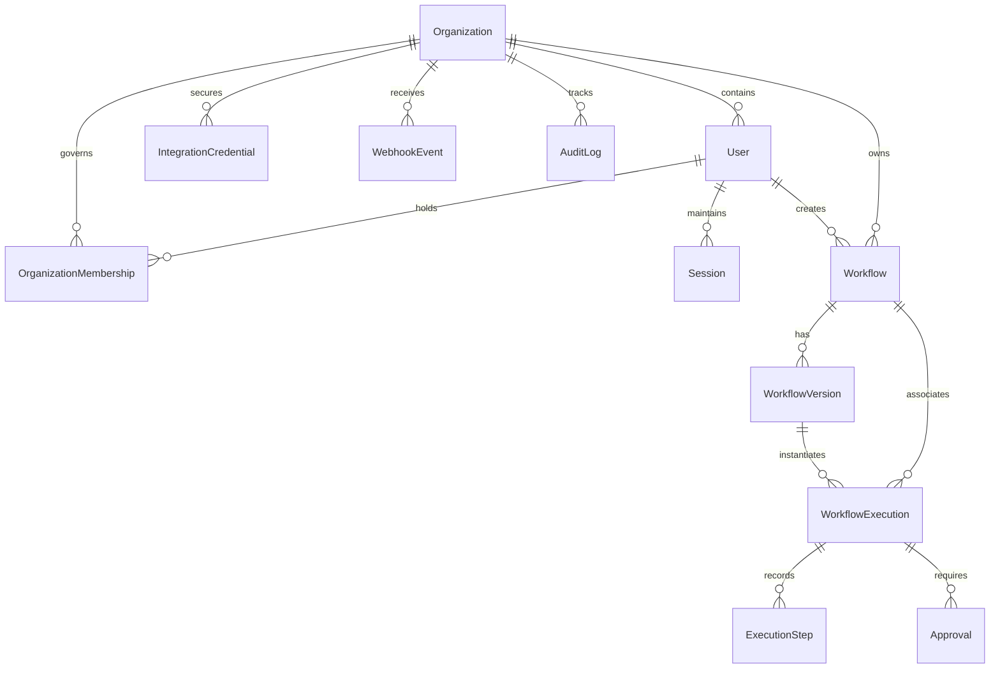

# FlowForge Database Schema Specification

## 1. Relational Entity Diagram

## 2. Core Tables & Field Definitions

### `organizations`

- `id`: UUID (PK)
- `name`: VARCHAR(255) NOT NULL
- `slug`: VARCHAR(255) UNIQUE NOT NULL
- `createdAt`: TIMESTAMPTZ NOT NULL DEFAULT NOW()
- `updatedAt`: TIMESTAMPTZ NOT NULL DEFAULT NOW()

### `users`

- `id`: UUID (PK)
- `email`: VARCHAR(255) UNIQUE NOT NULL (normalized lowercase)
- `passwordHash`: VARCHAR(255) NOT NULL (bcrypt / argon2id)
- `firstName`: VARCHAR(100)
- `lastName`: VARCHAR(100)
- `createdAt`: TIMESTAMPTZ NOT NULL DEFAULT NOW()
- `updatedAt`: TIMESTAMPTZ NOT NULL DEFAULT NOW()

### `organization_memberships`

- `id`: UUID (PK)
- `organizationId`: UUID REFERENCES organizations(id) ON DELETE CASCADE
- `userId`: UUID REFERENCES users(id) ON DELETE CASCADE
- `role`: ENUM ('OWNER', 'ADMIN', 'MEMBER') NOT NULL DEFAULT 'MEMBER'
- `createdAt`: TIMESTAMPTZ NOT NULL DEFAULT NOW()
- `UNIQUE (organizationId, userId)`: Prevents duplicate memberships for the same user in an organization.

### `sessions`

- `id`: UUID (PK)
- `userId`: UUID REFERENCES users(id) ON DELETE CASCADE
- `token`: VARCHAR(255) UNIQUE NOT NULL
- `ipAddress`: VARCHAR(45)
- `userAgent`: TEXT
- `expiresAt`: TIMESTAMPTZ NOT NULL
- `createdAt`: TIMESTAMPTZ NOT NULL DEFAULT NOW()

### `workflows`

- `id`: UUID (PK)
- `organizationId`: UUID REFERENCES organizations(id) ON DELETE CASCADE
- `name`: VARCHAR(255) NOT NULL
- `description`: TEXT
- `status`: ENUM ('DRAFT', 'ACTIVE', 'ARCHIVED') NOT NULL DEFAULT 'DRAFT'
- `draftDefinition`: JSONB NOT NULL DEFAULT '{"nodes":[],"edges":[]}'
- `publishedVersionId`: UUID
- `createdById`: UUID REFERENCES users(id) ON DELETE SET NULL
- `deletedAt`: TIMESTAMPTZ (Soft deletion / archival timestamp)
- `createdAt`: TIMESTAMPTZ NOT NULL DEFAULT NOW()
- `updatedAt`: TIMESTAMPTZ NOT NULL DEFAULT NOW()
- Indexes: `(organizationId)`, `(status)`, `(deletedAt)`

### `workflow_versions`

- `id`: UUID (PK)
- `workflowId`: UUID REFERENCES workflows(id) ON DELETE RESTRICT
- `versionNumber`: INTEGER NOT NULL
- `definition`: JSONB NOT NULL (Immutable graph snapshot)
- `publishedAt`: TIMESTAMPTZ NOT NULL DEFAULT NOW()
- `publishedById`: UUID REFERENCES users(id) ON DELETE SET NULL
- `UNIQUE (workflowId, versionNumber)`: Enforces monotonic, non-duplicate version sequencing per workflow.
- Invariant: `ON DELETE RESTRICT` ensures published versions cannot be purged if workflows are referenced.

### `workflow_executions`

- `id`: UUID (PK)
- `organizationId`: UUID REFERENCES organizations(id) ON DELETE CASCADE
- `workflowId`: UUID REFERENCES workflows(id) ON DELETE RESTRICT
- `workflowVersionId`: UUID REFERENCES workflow_versions(id) ON DELETE RESTRICT
- `triggerType`: ENUM ('MANUAL', 'WEBHOOK', 'SCHEDULE') NOT NULL
- `triggerPayload`: JSONB NOT NULL DEFAULT '{}'
- `status`: ENUM ('QUEUED', 'RUNNING', 'WAITING_APPROVAL', 'WAITING_DELAY', 'RETRYING', 'SUCCEEDED', 'FAILED', 'CANCELLED') NOT NULL DEFAULT 'QUEUED'
- `contextData`: JSONB NOT NULL DEFAULT '{}'
- `currentNodeId`: VARCHAR(100)
- `startedAt`: TIMESTAMPTZ
- `completedAt`: TIMESTAMPTZ
- `retryCount`: INTEGER NOT NULL DEFAULT 0
- `errorDetails`: JSONB
- `createdAt`: TIMESTAMPTZ NOT NULL DEFAULT NOW()
- `updatedAt`: TIMESTAMPTZ NOT NULL DEFAULT NOW()
- Indexes: `(organizationId)`, `(workflowId)`, `(status)`, `(createdAt)`
- Invariant: `ON DELETE RESTRICT` guarantees execution records are never cascade-deleted on workflow removal.

### `execution_steps`

- `id`: UUID (PK)
- `executionId`: UUID REFERENCES workflow_executions(id) ON DELETE CASCADE
- `nodeId`: VARCHAR(100) NOT NULL
- `nodeType`: VARCHAR(50) NOT NULL
- `nodeName`: VARCHAR(255) NOT NULL
- `status`: ENUM ('PENDING', 'RUNNING', 'COMPLETED', 'FAILED', 'SKIPPED', 'WAITING') NOT NULL DEFAULT 'PENDING'
- `inputPayload`: JSONB (Secrets masked)
- `outputPayload`: JSONB (Secrets masked)
- `errorMessage`: TEXT
- `startedAt`: TIMESTAMPTZ
- `completedAt`: TIMESTAMPTZ
- `attempt`: INTEGER NOT NULL DEFAULT 1
- Indexes: `(executionId)`, `(nodeId)`

### `approvals`

- `id`: UUID (PK)
- `organizationId`: UUID REFERENCES organizations(id) ON DELETE CASCADE
- `executionId`: UUID REFERENCES workflow_executions(id) ON DELETE CASCADE
- `stepId`: UUID REFERENCES execution_steps(id) ON DELETE CASCADE
- `title`: VARCHAR(255) NOT NULL
- `description`: TEXT
- `requiredRole`: ENUM ('OWNER', 'ADMIN', 'MEMBER') NOT NULL DEFAULT 'ADMIN'
- `status`: ENUM ('PENDING', 'APPROVED', 'REJECTED', 'TIMEOUT') NOT NULL DEFAULT 'PENDING'
- `decisionComment`: TEXT
- `decidedById`: UUID REFERENCES users(id) ON DELETE SET NULL
- `decidedAt`: TIMESTAMPTZ
- `createdAt`: TIMESTAMPTZ NOT NULL DEFAULT NOW()
- Indexes: `(organizationId)`, `(executionId)`, `(status)`

### `integration_credentials`

- `id`: UUID (PK)
- `organizationId`: UUID REFERENCES organizations(id) ON DELETE CASCADE
- `name`: VARCHAR(255) NOT NULL
- `type`: ENUM ('SMTP', 'API_KEY', 'BEARER_TOKEN', 'BASIC_AUTH') NOT NULL
- `encryptedData`: TEXT NOT NULL (AES-256-GCM encrypted ciphertext)
- `createdAt`: TIMESTAMPTZ NOT NULL DEFAULT NOW()
- `updatedAt`: TIMESTAMPTZ NOT NULL DEFAULT NOW()

### `webhook_events`

- `id`: UUID (PK)
- `organizationId`: UUID REFERENCES organizations(id) ON DELETE CASCADE
- `workflowId`: UUID REFERENCES workflows(id) ON DELETE RESTRICT
- `idempotencyKey`: VARCHAR(255)
- `source`: VARCHAR(255)
- `payload`: JSONB NOT NULL
- `status`: VARCHAR(50) NOT NULL DEFAULT 'PENDING'
- `createdAt`: TIMESTAMPTZ NOT NULL DEFAULT NOW()
- `UNIQUE (organizationId, idempotencyKey)`: Enforces durable deduplication for external webhooks.

### `audit_logs`

- `id`: UUID (PK)
- `organizationId`: UUID REFERENCES organizations(id) ON DELETE CASCADE
- `userId`: UUID REFERENCES users(id) ON DELETE SET NULL
- `action`: VARCHAR(100) NOT NULL
- `resourceType`: VARCHAR(100) NOT NULL
- `resourceId`: VARCHAR(255) NOT NULL
- `metadata`: JSONB (No passwords, tokens, or raw secrets)
- `ipAddress`: VARCHAR(45)
- `createdAt`: TIMESTAMPTZ NOT NULL DEFAULT NOW()
- Indexes: `(organizationId)`, `(createdAt)`

---

## 3. Deletion, Archival & Retention Policy

1. **Workflows**: Deletion in FlowForge is managed via soft-delete archival:
   - When a workflow is retired, `status` transitions to `ARCHIVED` and `deletedAt` is recorded.
   - Hard deletion (`DELETE FROM workflows`) is restricted by foreign key constraints (`ON DELETE RESTRICT`) whenever executions or versions exist.
2. **Execution History Retention**:
   - `workflow_executions`, `execution_steps`, and `approvals` constitute the legal audit record of business operations.
   - Deleting a workflow NEVER purges historical executions.
3. **Audit Log Permanence**:
   - `audit_logs` entries cannot be updated or deleted by normal application transactions.
