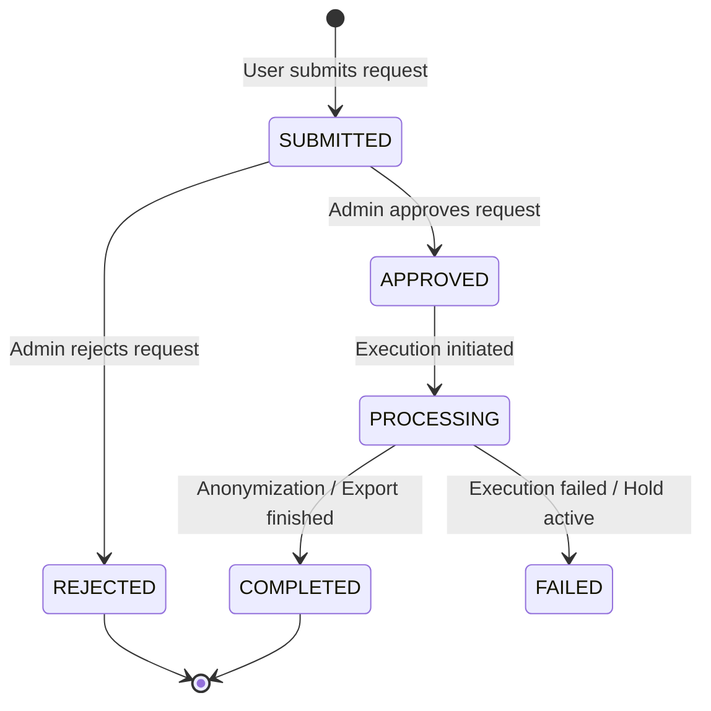

# FlowForge Enterprise Compliance, Audit Governance, Data Retention, and Privacy Controls

## 1. Executive Summary & Scope

FlowForge provides a comprehensive enterprise compliance, audit governance, data retention, and privacy management subsystem. Designed to meet the technical standards required by SOC 2 Type II, ISO/IEC 27001:2022, GDPR, and the HIPAA Security Rule, the platform establishes provable operational controls across:

- **Tamper-Evident Audit Logging**: Cryptographically verifiable SHA-256 hash chaining with automated metadata redaction.
- **Audit Search & Safe Export**: Multi-dimensional filtering, pagination, and CSV formula-injection defense.
- **Configurable Data Retention Engine**: Category-specific retention policies, platform-enforced minimum retention floors, and bounded batch cleanup.
- **Legal Holds & Data Preservation**: Active preservation orders that freeze automated data deletion across target organizations, users, or workflows.
- **Data Classification & Sanitization**: Strict 4-tier data classification (`PUBLIC`, `INTERNAL`, `CONFIDENTIAL`, `RESTRICTED`) and automated payload masking.
- **Auditable Privacy Workflows**: Standardized lifecycle for GDPR/CCPA Data Subject Requests (Access, Export, Correction, Deletion, and Restriction), executing compliant user anonymization while preserving immutable audit trails.
- **Live Technical Control Inventory**: Transparent API-accessible control catalog mapping platform capabilities to compliance frameworks.

> [!IMPORTANT]
> Technical compliance controls implement the technical mechanisms required by regulations and security standards. Implementation of these engineering controls does not constitute legal certification, independent audit assurance, or formal regulatory approval.

---

## 2. Centralized Audit Event Architecture & Tamper-Evident Hash Chaining

### 2.1 Structured Audit Schema

Every governance-relevant action in FlowForge generates a structured audit log containing:

- `id`: Unique event identifier (`audit_<timestamp>_<random>`).
- `organizationId`: Multi-tenant organization scope.
- `workspaceId`: Specific workspace identifier (when applicable).
- `actorType`: Identity origin (`USER`, `API_KEY`, `OAUTH_CLIENT`, `SYSTEM`).
- `actorId` / `userId`: Actor identifier.
- `authMethod`: Authentication context (`SESSION`, `API_KEY`, `OAUTH`, `SSO`, `SCIM`, `SYSTEM`).
- `action`: Specific domain action (e.g. `workflow.published`, `legal_hold.created`, `privacy.request.executed`).
- `resourceType` and `resourceId`: Target entity.
- `outcome`: Action result (`SUCCESS`, `FAILURE`, `DENIED`).
- `ipAddress` and `userAgent`: Source network telemetry.
- `correlationId`: Distributed request tracing identifier (`X-Correlation-Id`).
- `metadata`: Sanitized JSON payload.
- `prevRecordHash`: SHA-256 hash of the immediately preceding audit event in the organization.
- `recordHash`: SHA-256 hash verifying event content and chain continuity.
- `createdAt`: UTC timestamp.

### 2.2 Sensitive Metadata Sanitization

Prior to persistence in storage or database, all audit event metadata passes through `sanitizeAuditMetadata()`. Any property key matching sensitive credential patterns (`password`, `secret`, `token`, `key`, `authorization`, `apiKey`, `clientSecret`) is recursively replaced with `"[REDACTED]"`.

### 2.3 Tamper-Evident SHA-256 Hash Chaining

Audit logs within an organization form an append-only cryptographic chain. The event hash is computed as:

$$\text{recordHash} = \text{SHA-256}(\text{prevRecordHash} + ":" + \text{id} + ":" + \text{ISO-timestamp} + ":" + \text{orgId} + ":" + \text{action} + ":" + \text{resourceType} + ":" + \text{resourceId} + ":" + \text{outcome} + ":" + \text{sanitizedMetadata})$$

The first event in an organization anchors to `GENESIS_HASH`.

### 2.4 Integrity Verification & Anomaly Detection

Authorized administrators can verify audit chain continuity via:
`POST /api/v1/organizations/:id/audit/verify`

If an attacker modifies a stored audit record, deletes an event, or alters event metadata:

1. Recalculated hash diverges from `recordHash`, or `prevRecordHash` breaks chain continuity.
2. The verification API returns `{ verified: false, brokenRecordId: "<id>", expectedHash, actualHash }`.
3. An `OperationalAlert` is immediately raised with severity `CRITICAL` and rule `AUDIT_TAMPER_DETECTED`.

---

## 3. Audit Search, Filtering, and Export Governance

### 3.1 Multi-Dimensional Filtering & Pagination

The endpoint `GET /api/v1/organizations/:id/audit-logs` (aliased to `/audit`) supports:

- `page` and `pageSize`: Bounded cursor pagination.
- `action`: Exact or partial action matching.
- `resourceType` and `resourceId`: Entity targeting.
- `actorId` and `actorType`: Identity filtering.
- `outcome`: `SUCCESS`, `FAILURE`, `DENIED`.
- `from` and `to`: ISO date range filters.
- `workspaceId`: Workspace isolation filtering.
- `correlationId`: Trace cross-referencing.

### 3.2 Secure Export & CSV Formula-Injection Defense

Audit logs can be exported via `POST /api/v1/organizations/:id/audit/export` in `json` or `csv` formats:

- **Maximum Export Size**: Capped at 5,000 records per request to prevent denial of service.
- **Auditable Generation**: The export action itself generates a permanent audit event (`audit.logs.exported`).
- **CSV Formula Injection Defense**: When generating CSV output, user-controlled values beginning with dangerous characters (`=`, `+`, `-`, `@`, `\t`, `\r`) are automatically escaped by prefixing a single quote (`'`), preventing malicious spreadsheet formula execution upon opening.

---

## 4. Policy-Driven Data Retention Framework

### 4.1 Categorized Retention Policies

Rather than applying arbitrary blanket deletion, FlowForge categorizes data according to legal, operational, and regulatory lifecycles:

| Category                  | Default Retention | Minimum Allowed              | Description                                            |
| :------------------------ | :---------------- | :--------------------------- | :----------------------------------------------------- |
| `AUDIT_LOGS`              | 365 days          | **90 days (Platform Floor)** | Security and compliance audit events                   |
| `WORKFLOW_EXECUTIONS`     | 90 days           | 1 day                        | Workflow execution runs and status records             |
| `EXECUTION_LOGS`          | 30 days           | 1 day                        | Detailed step outputs and execution logs               |
| `WORKFLOW_VERSIONS`       | 365 days          | 30 days                      | Published workflow version definitions                 |
| `WEBHOOK_DELIVERIES`      | 30 days           | 1 day                        | Inbound/outbound webhook delivery attempts             |
| `NOTIFICATION_DELIVERIES` | 30 days           | 1 day                        | Dispatched emails and notifications                    |
| `EXPORTS_TEMPORARY`       | 7 days            | 1 day                        | Generated ZIP/JSON backup and privacy export artifacts |
| `PRIVACY_REQUESTS`        | 365 days          | 90 days                      | Privacy request records and outcome summaries          |
| `FINANCIAL_INVOICES`      | **Immutable**     | **Permanent**                | Billing records and invoices are immutable             |

### 4.2 Platform Restriction Floors

To prevent rogue administrators or compromised credentials from wiping security logs:

- Any attempt to configure `AUDIT_LOGS` retention below **90 days** is rejected with `400 INVALID_RETENTION_POLICY`.
- All retention policy updates emit audit log `retention.policy.updated`.

### 4.3 Retention Preview & Background Batch Processing

- **Preview API**: `POST /api/v1/organizations/:id/retention/preview` returns record counts eligible for purge and records protected by active Legal Holds without altering storage.
- **Batch Cleanup**: `POST /api/v1/organizations/:id/retention/jobs` runs bounded batch processing (50-100 items per step) to avoid table lock contention.
- **Durable Job Records**: Every execution persists a `RetentionJobRecord` tracking status, evaluated count, purged count, and errors.

---

## 5. Legal Holds & Preservation Controls

Legal holds prevent automated retention cleanup from deleting potentially discoverable evidence during active litigation, government investigations, or regulatory inquiries.

### 5.1 Legal Hold Architecture

- `targetType`:
  - `ORGANIZATION`: All records in the organization across specified categories.
  - `USER`: Records created by or targeting a specific user.
  - `WORKFLOW`: Records associated with a specific workflow ID.
  - `CATEGORY`: Organization-wide hold on a specific data category.
- `categories`: Array of targeted retention categories (e.g. `["AUDIT_LOGS", "WORKFLOW_EXECUTIONS"]`).
- `status`: `ACTIVE` or `RELEASED`.

### 5.2 Preservation Enforcement

During retention cleanup, the engine evaluates each candidate record:
$$\text{eligibleForPurge} = (\text{recordDate} < \text{cutoffDate}) \land \neg \text{isCoveredByActiveLegalHold}(\text{record})$$
Records covered by an active hold are strictly preserved and skipped during deletion.

### 5.3 Release Workflow

Holds are released via `POST /api/v1/organizations/:id/legal-holds/:holdId/release`:

- Requires mandatory `releaseReason`.
- Records `releasedById` and `releasedAt`.
- Emits audit event `legal_hold.released`.
- Subsequent retention jobs resume normal cleanup eligibility for formerly held records.

---

## 6. Data Classification & Minimization Matrix

FlowForge establishes four clear data classifications:

| Classification   | Scope                       | Examples                                                     | Handling & Protection                                               |
| :--------------- | :-------------------------- | :----------------------------------------------------------- | :------------------------------------------------------------------ |
| **PUBLIC**       | Freely shareable            | Public workflow templates, system health status              | Accessible without authentication                                   |
| **INTERNAL**     | Organization members        | Org name, workspace slugs, member display names              | Requires authenticated organization membership                      |
| **CONFIDENTIAL** | Least-privilege operations  | Workflow graphs, execution payloads, comments, audit logs    | Enforced via role-based permissions (`workflow:read`, `audit:read`) |
| **RESTRICTED**   | Cryptographically protected | Passwords, AES encryption keys, API keys, OAuth secrets, PII | AES-256-GCM encryption, bcrypt hashing, recursive redaction         |

---

## 7. Privacy Request Management (GDPR/CCPA/Portability)

FlowForge provides an end-to-end Data Subject Request workflow handling the complete privacy lifecycle:

### 7.1 Supported Request Types

1. **ACCESS**: Summary of personal profile, memberships, and assigned workflow approvals.
2. **EXPORT**: Complete personal data portability bundle with short-lived download token.
3. **CORRECTION**: Rectification of inaccurate user profile fields.
4. **DELETION**: Compliant right-to-be-forgotten erasure.
5. **RESTRICTION**: Soft suspension of account processing.

### 7.2 Compliant User Deletion & Anonymization

To balance GDPR Article 17 ("Right to Erasure") with SOC 2 / GDPR Article 30 audit integrity requirements:

- **Personal Data Scrubber**:
  - `email` $\to$ `deleted_<userId>@anonymized.flowforge.internal`
  - `firstName` $\to$ `"Anonymized"`
  - `lastName` $\to$ `"User"`
  - `passwordHash` $\to$ `""`
  - `active` $\to$ `false`
- **Session Revocation**: Immediately terminates all active user sessions across all devices.
- **Audit Preservation**: The user's internal ID is retained in existing audit logs, preserving historical integrity while scrubbing personal identifiers from metadata.
- **Workflow Preservation**: Workflow definitions created by the user remain functional for the organization.

### 7.3 Legal Hold Safeguard

If a deletion or restriction request is executed against a user covered by an active Legal Hold, the system aborts execution with `409 LEGAL_HOLD_ACTIVE`, preventing accidental destruction of legally discoverable evidence.

### 7.4 Secure Artifact Portability

When an `EXPORT` or `ACCESS` request is completed:

- Generates a short-lived download link with 1-hour expiration.
- Requires both bearer authentication and matching download token (`GET .../artifact?token=...`).
- Links expire automatically with `410 EXPIRED`.

---

## 8. Compliance Evidence & Technical Control Inventory

FlowForge maintains a live technical control inventory accessible via:
`GET /api/v1/organizations/:id/compliance/controls`

### Implemented Technical Control Matrix

| Control ID           | Framework   | Control Title                                | Implementation Status | Evidence / Code References                                                        |
| :------------------- | :---------- | :------------------------------------------- | :-------------------- | :-------------------------------------------------------------------------------- |
| **SOC2-CC6.1**       | SOC 2       | Logical Access Controls & Least Privilege    | `IMPLEMENTED`         | `apps/api/src/middleware/rbac.ts`, `packages/shared/src/index.ts`                 |
| **SOC2-CC6.2**       | SOC 2       | User Registration & Multi-Protocol Auth      | `IMPLEMENTED`         | `apps/api/src/routes/auth.routes.ts`, `apps/api/src/services/identity.service.ts` |
| **SOC2-CC6.3**       | SOC 2       | Immediate Access Revocation & SCIM           | `IMPLEMENTED`         | `apps/api/src/services/identity.service.ts`, `apps/api/src/routes/scim.routes.ts` |
| **SOC2-CC6.6**       | SOC 2       | Data Encryption in Transit & at Rest         | `IMPLEMENTED`         | `apps/api/src/routes/credential.routes.ts` (AES-256-GCM), TLS enforcement         |
| **SOC2-CC7.1**       | SOC 2       | Vulnerability Management & Dependency Checks | `IMPLEMENTED`         | `.github/workflows/ci.yml` (automated test & lint pipeline)                       |
| **SOC2-CC7.2**       | SOC 2       | Security Monitoring & Anomaly Detection      | `IMPLEMENTED`         | `apps/api/src/services/compliance.service.ts` (`AUDIT_TAMPER_DETECTED`)           |
| **SOC2-CC7.3**       | SOC 2       | Operational Incident Management & Response   | `IMPLEMENTED`         | `apps/api/src/routes/incident.routes.ts`                                          |
| **SOC2-A1.2**        | SOC 2       | Data Retention & Compliant Disposal          | `IMPLEMENTED`         | `apps/api/src/services/compliance.service.ts`, `retention_policies` schema        |
| **ISO-A.5.15**       | ISO 27001   | Access Control & Machine Authentication      | `IMPLEMENTED`         | `apps/api/src/services/oauth.service.ts` (RFC 6749 Client Credentials)            |
| **ISO-A.8.10**       | ISO 27001   | Information Deletion & Anonymization         | `IMPLEMENTED`         | `apps/api/src/services/compliance.service.ts` (`executePrivacyRequest`)           |
| **ISO-A.8.11**       | ISO 27001   | Data Masking & Metadata Sanitization         | `IMPLEMENTED`         | `packages/test-utils/src/index.ts` (`sanitizeAuditMetadata`)                      |
| **ISO-A.8.12**       | ISO 27001   | Data Leakage Prevention & SSRF Defense       | `IMPLEMENTED`         | `apps/api/src/routes/webhook.routes.ts` (Private IPv4/IPv6 blocking)              |
| **GDPR-Art.15**      | GDPR        | Right of Access by Data Subject              | `IMPLEMENTED`         | `apps/api/src/routes/compliance.routes.ts` (`PrivacyRequestType: ACCESS`)         |
| **GDPR-Art.17**      | GDPR        | Right to Erasure with Hold Protection        | `IMPLEMENTED`         | `apps/api/src/services/compliance.service.ts` (`DELETION` anonymization)          |
| **GDPR-Art.20**      | GDPR        | Right to Data Portability                    | `IMPLEMENTED`         | `apps/api/src/routes/compliance.routes.ts` (Time-limited artifact link)           |
| **GDPR-Art.30**      | GDPR        | Records of Processing Activities             | `IMPLEMENTED`         | `packages/database/prisma/schema.prisma` (`audit_logs` hash chaining)             |
| **HIPAA-164.312(b)** | HIPAA       | Audit Controls & Verification                | `IMPLEMENTED`         | `apps/api/src/services/compliance.service.ts` (`verifyAuditChain`)                |
| **HIPAA-164.312(a)** | HIPAA       | Encryption and Decryption Controls           | `IMPLEMENTED`         | `apps/api/src/routes/credential.routes.ts` (AES-256-GCM)                          |
| **EXT-BACKUP**       | SOC 2 / ISO | Cloud WORM Storage & Backup Retention        | `EXTERNAL_DEPENDENCY` | Customer cloud provider object locking (AWS S3 Lock, GCS Bucket Lock)             |

---

## 9. Operational Runbooks

### 9.1 Investigating Audit Chain Verification Failures

1. **Alert Trigger**: An `AUDIT_TAMPER_DETECTED` alert is generated with `brokenRecordId`.
2. **Investigation Steps**:
   - Query `POST /api/v1/organizations/:id/audit/verify` to retrieve `brokenRecordId`, `expectedHash`, and `actualHash`.
   - Inspect the database entry for `brokenRecordId` in table `audit_logs`.
   - Check database access logs to identify direct SQL modifications outside the application layer.
   - Cross-reference `correlationId` with application load balancer access logs.
3. **Remediation**:
   - Isolate compromised credentials immediately.
   - File an operational incident via `POST /api/v1/incidents`.
   - Restore audit records from air-gapped immutable backup if modification occurred.

### 9.2 Managing & Releasing Legal Holds

1. **Creation**:
   - Submit `POST /api/v1/organizations/:id/legal-holds` with the exact litigation matter, scope (user, workflow, or org), and target categories.
2. **Periodic Review**:
   - Compliance team reviews active holds quarterly via `GET /api/v1/organizations/:id/legal-holds?status=ACTIVE`.
3. **Release Procedure**:
   - When litigation concludes or settlement is reached, issue `POST /.../legal-holds/:holdId/release` with documented `releaseReason`.
   - Trigger a dry-run retention preview to evaluate newly eligible records: `POST /.../retention/preview`.

### 9.3 Recovering Interrupted Retention Cleanup Jobs

1. If a background retention worker crashes or restarts mid-job:
   - Retention jobs are idempotent: re-running does not double-delete or corrupt state.
   - Inspect past jobs via `GET /api/v1/organizations/:id/retention/jobs`.
   - Trigger a fresh cleanup run via `POST /api/v1/organizations/:id/retention/jobs`.

---

## 10. Empirical Verification Evidence

The enterprise compliance subsystem is validated by a dedicated test suite (`tests/integration/enterprise-compliance-governance.test.ts`):

- **Dedicated Compliance Suite**: **27 / 27 tests passed**
- **Full Monorepo Integration Suite**: **595 / 595 tests passed across 37 test files**
- **TypeScript Type Checking**: `pnpm typecheck` passed with **0 errors**.
- **ESLint Linting**: `pnpm lint` passed with **0 errors, 0 warnings**.
- **Production Build**: Clean compilation of all packages and Next.js 14 applications.
