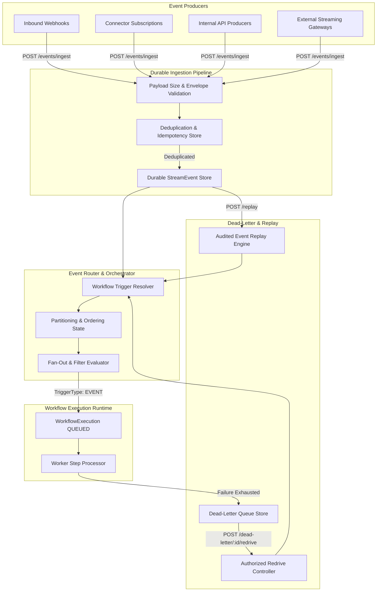

# Enterprise Event Streaming, Real-Time Data Integration, and Event-Driven Orchestration

## 1. Architectural Overview & Data Flow

FlowForge provides an enterprise-grade event streaming and real-time data integration layer that ingests, validates, normalizes, routes, and orchestrates business events across external webhook providers, connector subscriptions, internal platform producers, and authorized API clients.

The event-driven engine is architected around the **Canonical Event Envelope**, zero-trust tenant boundary enforcement, durable persistence before acknowledgment, and seamless integration with FlowForge's canonical workflow execution runtime.

---

## 2. Canonical Event Envelope Specification

All events entering FlowForge are normalized into a standardized event envelope based on modern enterprise cloud-event patterns:

| Field                | Type       | Description                                                      | Mandatory                    |
| :------------------- | :--------- | :--------------------------------------------------------------- | :--------------------------- |
| `id`                 | `string`   | Globally unique identifier (e.g., `evt_...` or UUID)             | Yes (Generated if omitted)   |
| `type`               | `string`   | Hierarchical event type (e.g., `order.created`, `invoice.paid`)  | **Yes**                      |
| `specVersion`        | `string`   | Specification version (defaults to `"1.0"`)                      | Yes                          |
| `organizationId`     | `string`   | Trusted tenant identifier (enforced from auth context)           | System Enforced              |
| `workspaceId`        | `string`   | Optional workspace isolation boundary                            | Optional                     |
| `source`             | `string`   | Originating connector or service (e.g., `shopify`, `stripe`)     | **Yes**                      |
| `connectorId`        | `string`   | Associated integration connector instance                        | Optional                     |
| `subject`            | `string`   | Target business entity identifier (e.g., `order_1001`)           | Optional                     |
| `time`               | `DateTime` | Event creation timestamp at producer                             | Yes (Defaults to now)        |
| `ingestedAt`         | `DateTime` | Exact timestamp of platform acceptance                           | System Enforced              |
| `correlationId`      | `string`   | Distributed tracing correlation identifier                       | Yes (Generated if omitted)   |
| `causationId`        | `string`   | Parent event ID triggering this event                            | Optional                     |
| `partitionKey`       | `string`   | Key used for per-entity ordering guarantees                      | Optional                     |
| `traceId`            | `string`   | W3C trace context identifier                                     | Optional                     |
| `spanId`             | `string`   | Parent span identifier                                           | Optional                     |
| `contentType`        | `string`   | Payload MIME type (defaults to `application/json`)               | Yes                          |
| `data`               | `Record`   | Structured business event payload                                | Yes (Defaults to `{}`)       |
| `metadata`           | `Record`   | Operational and routing metadata                                 | Optional                     |
| `dataClassification` | `enum`     | Sensitivity (`PUBLIC`, `INTERNAL`, `CONFIDENTIAL`, `RESTRICTED`) | Yes (Defaults to `INTERNAL`) |

---

## 3. Delivery Semantics & Idempotency

### At-Least-Once Delivery

FlowForge guarantees **at-least-once delivery** from ingestion through workflow trigger dispatch. Transient failures during downstream step execution are retried via worker retries, dead-letter storage, or authorized redrive.

### Deduplication Window

- **Default Window**: 7 days (`604,800,000` ms).
- **Concurrency-Safe Store**: `EventDeduplication` table enforces a unique constraint on `(organizationId, deduplicationKey)`.
- **Deduplication Key Determination**:
  1. `req.body.idempotencyKey`
  2. `X-Idempotency-Key` or `X-Event-ID` request headers
  3. Producer-supplied `event.id`
  4. Content-derived SHA-256 hash: `${type}:${source}:${sha256(data)}`
- **Duplicate Handling**: Duplicate events received within the deduplication window are acknowledged immediately with `HTTP 200 OK` and `{ duplicate: true, eventId, status }` without re-creating workflow executions or duplicating external side-effects.

---

## 4. Ordering, Partitioning, and Concurrency

FlowForge supports **per-entity partition ordering** rather than global serialization:

- **`partitionKey`**: When provided (e.g., `account_id`, `customer_id`), events are tracked sequentially within the partition.
- **Partition State Tracking**: Tracks sequence numbers and last processed event timestamps per `organizationId:partitionKey`.
- **Poison Event Isolation**: A failing event within partition `A` escalates to `DEAD_LETTERED` after max attempts, preventing deadlock and allowing subsequent events or unrelated partitions to continue uninterrupted.

---

## 5. Retry, Dead-Letter Queue (DLQ), and Redrive

### Exponential Backoff

Events that fail during initial processing or trigger dispatch are retried with exponential backoff and jitter:
$$\text{delayMs} = 2^{\text{attempts}} \times 1,000 + \text{jitter}(0, 500\text{ms})$$

### Dead-Letter Queue

- When `attempts >= maxAttempts` (default: 3) or when encountering unrecoverable validation/authentication errors, events transition to `DEAD_LETTERED`.
- The event record retains the original diagnostic error message (`errorMessage`) and failure context (`errorDetails`) while preserving the original payload.

### Authorized Redrive

- **Endpoint**: `POST /api/v1/organizations/:organizationId/events/dead-letter/:id/redrive`
- **Permission**: Requires `events:write` or `events:admin`.
- **Behavior**: Verifies `DEAD_LETTERED` status, resets `attempts = 0`, clears error fields, triggers fresh workflow routing, and logs an immutable audit event (`event.dead_letter_redriven`).

---

## 6. Event Replay & Disaster Recovery

FlowForge provides controlled historical event replay for debugging, model retraining, and recovery from downstream outages.

### Replay Safeguards

1. **Scope Preview**: `POST /api/v1/organizations/:organizationId/events/replay/preview` analyzes the query filter, reporting matching event counts and eligible target workflows without dispatching executions.
2. **Replay Execution**: `POST /api/v1/organizations/:organizationId/events/replay` creates explicit replayed event copies with:
   - Unique replayed event ID (`evt_replay_...`)
   - `replayedFromId` referencing the historical event
   - `isReplay: true` metadata flag
   - `replayedById` recording the authorized operator
3. **Audit Trail**: Every replay operation generates a `event.replay_executed` audit log entry with filter parameters and execution totals.
4. **RBAC Guard**: Strictly requires `events:replay` or `events:admin` permissions.

---

## 7. Connector Event Subscriptions

Connectors supporting inbound webhooks or streaming publish capabilities can be managed programmatically:

| Method   | Endpoint                    | Description                           | Required Scope                       |
| :------- | :-------------------------- | :------------------------------------ | :----------------------------------- |
| `POST`   | `/events/subscriptions`     | Create connector event subscription   | `connections:write` / `events:write` |
| `GET`    | `/events/subscriptions`     | List active & suspended subscriptions | `connections:read` / `events:read`   |
| `GET`    | `/events/subscriptions/:id` | Get subscription details & health     | `connections:read` / `events:read`   |
| `PATCH`  | `/events/subscriptions/:id` | Update status (`ACTIVE`, `SUSPENDED`) | `connections:write` / `events:write` |
| `DELETE` | `/events/subscriptions/:id` | Tear down subscription                | `connections:write` / `events:write` |

---

## 8. REST API Reference

All routes are mounted under `/api/v1/organizations/:organizationId/events` (and `/api/v1/events`).

### Ingestion

`POST /api/v1/organizations/:organizationId/events/ingest`

- **Header**: `Authorization: Bearer <token>` or `X-API-Key: <key>`
- **Payload**: Canonical event object or `{ events: [...] }` batch array.
- **Response**: `202 Accepted` on new ingestion, `200 OK` on duplicate.

### Explorer & Querying

`GET /api/v1/organizations/:organizationId/events`

- **Query Params**: `type`, `source`, `status`, `partitionKey`, `correlationId`, `from`, `to`, `limit`, `offset`.

### Single Event Inspection

`GET /api/v1/organizations/:organizationId/events/:id?redact=true`

- **Redaction**: Automatically masks sensitive credential and token keys (`token`, `apiKey`, `password`, `secret`) with bullets `••••••••`.

### Metrics & Observability

`GET /api/v1/organizations/:organizationId/events/metrics`

- **Response**: Real-time aggregated counters (`totalIngested`, `totalRouted`, `totalDuplicates`, `totalDeadLettered`, `queueLagMs`, `byEventType`, `bySource`).

---

## 9. Security, Governance & Tenant Isolation

1. **Authentication**: All streaming APIs enforce session authentication, API keys with granular scopes (`events:read`, `events:ingest`, `events:write`, `events:replay`), or OAuth 2.0 client credentials.
2. **Tenant Isolation**: Ingestion strictly grounds events in the authenticated organization ID, ignoring client-supplied overrides. Cross-tenant reads, replays, or redrives return `403 Forbidden`.
3. **Payload Protection**: Events are subject to a strict 1MB size threshold, neutralizing memory-exhaustion DoS attacks.
4. **Data Redaction**: Sensitive attributes are masked in API inspection endpoints unless explicitly inspected by an authorized administrator.
5. **Tamper-Evident Audit Logging**: All lifecycle changes, replay operations, and redrives are recorded with SHA-256 hash chains.
