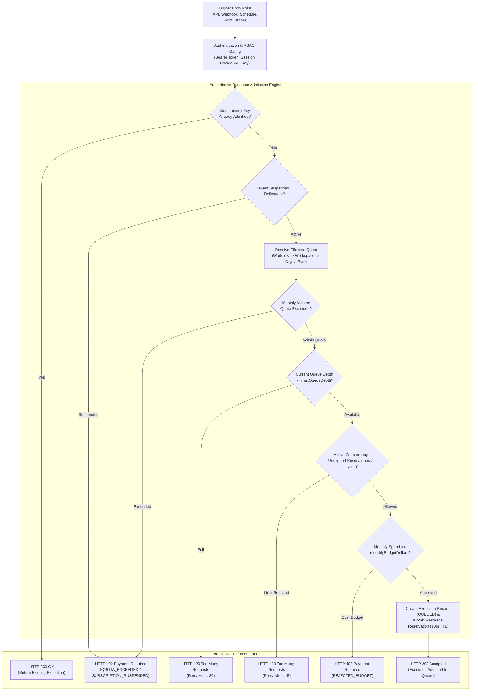

# FlowForge Enterprise Resource Governance, Execution Quotas, Fair Scheduling, and Cost Controls

## 1. Executive Summary & Guarantees

FlowForge delivers an enterprise-grade resource governance system designed to enforce tenant quotas, prevent noisy-neighbor starvation, interleave workloads fairly, and guarantee predictable operational cost ceilings across all entry points.

The resource governance engine works in tandem with the workflow execution runtime, background workers, event-streaming infrastructure, subscription metering, and audit logging.

### Core Guarantees:

1. **Multi-Tier Hierarchical Quota Resolution**: Policies resolve with strict deterministic precedence: Workflow-Specific Overrides → Workspace-Specific Overrides → Organization Default Quota → Subscription Plan Entitlements.
2. **Authoritative Atomic Admission Boundary**: All trigger avenues (`POST /api/v1/workflows/:id/execute`, inbound webhooks, scheduled triggers, and event streams) must pass through a single unified admission controller (`admitExecution`) before any execution record or worker task is created.
3. **Queue Depth Backpressure**: When an organization reaches its configured `maxQueueDepth`, new trigger requests are immediately rejected with HTTP `429 Too Many Requests` and a standard `Retry-After: 30` header.
4. **Deficit Round Robin Fair Scheduling**: Queue dispatching does not operate as naive FIFO. Worker loops interleave tasks across organizations according to their configured `fairShareWeight`, ensuring high-volume tenants cannot monopolize worker capacity or starve interactive tenants.
5. **Runtime Execution Budgets**: Workers enforce per-run execution timeouts (`maxExecutionDurationMs`), maximum step limits (`maxStepCount`), and maximum connector/HTTP call budgets (`maxConnectorCallsPerRun`). Violations transition runs to `FAILED` with explicit `RESOURCE_BUDGET_EXCEEDED` codes.
6. **Financial Cost Guardrails**: Real-time compute spend estimates are compared against the organization's `monthlyBudgetDollars`. Crossing the 80% threshold triggers proactive operational alerts, while exceeding 100% blocks further discretionary dispatches with HTTP `402 Payment Required`.
7. **Leak-Proof Resource Reconciliation**: Active concurrency reservations utilize a 10-minute safety TTL. An automated and on-demand reconciliation endpoint prunes orphaned reservations and recovers zombie executions older than 30 minutes.

---

## 2. Architecture & Admission Lifecycle

---

## 3. Fair Scheduling (Deficit Round Robin)

To prevent noisy-neighbor starvation, background execution runners do not dispatch tasks using naive First-In, First-Out (FIFO) queue order across the global fleet.

```mermaid
flowchart LR
    subgraph GlobalQueue["Global In-Memory / Distributed Queue"]
        OrgA1["Tenant A (High Volume)"]
        OrgA2["Tenant A (High Volume)"]
        OrgA3["Tenant A (High Volume)"]
        OrgB1["Tenant B (Low Volume)"]
        OrgC1["Tenant C (Interactive)"]
    end

    subgraph FairDispatcher["scheduleFairBatch(batchSize)"]
        DRR["Deficit Round Robin Interleaver\n(Tenant-partitioned FIFO with Quanta Accumulation)"]
    end

    subgraph DispatchedBatch["Interleaved Execution Batch"]
        Batch1["1. Tenant A (Run 1)"]
        Batch2["2. Tenant B (Run 1)"]
        Batch3["3. Tenant C (Run 1)"]
        Batch4["4. Tenant A (Run 2)"]
    end

    GlobalQueue --> FairDispatcher
    FairDispatcher --> DispatchedBatch
```

- Each tenant receives a deficit counter proportional to their configured `fairShareWeight`.
- In each dispatch cycle, worker instances service one item from each active tenant before rotating back to high-volume tenants.
- Interactive tenants (e.g., Tenant B and Tenant C above) receive prompt processing without waiting behind thousands of background events queued by Tenant A.

---

## 4. Runtime Execution Budgets

Workers wrap execution steps with active guardrails:

| Budget Dimension    | Default Limit      | Enforcement Mechanism                       | Failure Error Code                          |
| :------------------ | :----------------- | :------------------------------------------ | :------------------------------------------ |
| **Duration**        | 300,000 ms (5 min) | `AbortController` timer aborts execution    | `RESOURCE_BUDGET_EXCEEDED: DURATION`        |
| **Step Count**      | 100 steps          | Graph traversal step counter breaks loop    | `RESOURCE_BUDGET_EXCEEDED: STEPS`           |
| **Connector Calls** | 50 invocations     | Outbound HTTP/Connector counter breaks loop | `RESOURCE_BUDGET_EXCEEDED: CONNECTOR_CALLS` |

When a budget limit is reached:

1. The execution is transitioned to `FAILED`.
2. A detailed `errorDetails` object is attached with the dimension and specific limit reached.
3. A `workflow.execution.failed` domain event is published.
4. Active leases and resource reservations are released in the runner's `finally` block.

---

## 5. REST API Reference

All resource governance endpoints require authentication and standard RBAC permissions.

| Method | Endpoint                                | Required Permission | Description                                                                                                                 |
| :----- | :-------------------------------------- | :------------------ | :-------------------------------------------------------------------------------------------------------------------------- |
| `GET`  | `/api/v1/governance/quotas`             | `quotas:read`       | List all configured quota policy overrides for the organization.                                                            |
| `GET`  | `/api/v1/governance/quotas/effective`   | `quotas:read`       | Resolve the effective quota for a given `workspaceId` and `workflowId`.                                                     |
| `POST` | `/api/v1/governance/quotas`             | `quotas:write`      | Create or update an organization, workspace, or workflow quota policy.                                                      |
| `GET`  | `/api/v1/governance/quotas/utilization` | `quotas:read`       | Retrieve real-time active concurrency, queue depth, monthly volume, and health status (`HEALTHY`, `CONGESTED`, `CRITICAL`). |
| `GET`  | `/api/v1/governance/quotas/budget`      | `quotas:read`       | Retrieve monthly budget consumption, 80% threshold alert state, and spend estimates.                                        |
| `POST` | `/api/v1/governance/quotas/reconcile`   | `quotas:admin`      | Prune expired reservations (>10 min) and recover stale running executions (>30 min).                                        |

---

## 6. Frontend Administration (`/quotas`)

FlowForge provides a dedicated management interface at `/quotas` with 4 operational views:

- **Resource Utilization**: Live gauges for Active Concurrency, Queue Depth, and Monthly Volume with health status indicators.
- **Quota Policies**: Configuration form for creating Organization, Workspace, or Workflow overrides with precedence indicators.
- **Cost Budgets**: Financial ceiling tracker, projected end-of-month spend, and threshold warning alerts.
- **Fair Scheduling**: Deficit Round Robin weight configurations and anti-starvation controls.
