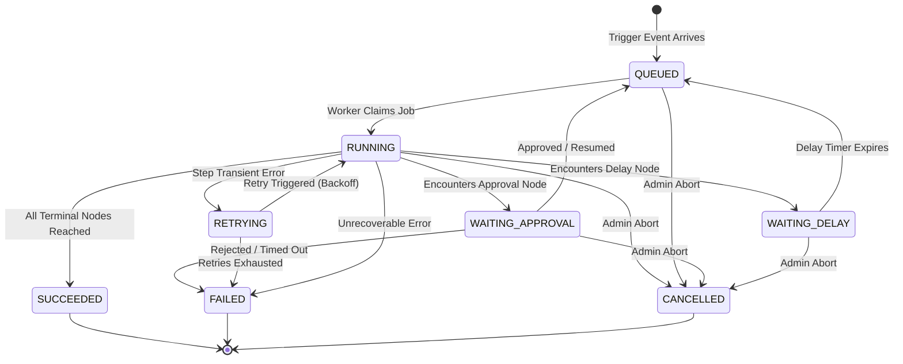

# FlowForge Execution State Machine

## 1. Execution Lifecycle States

## 2. Transition Matrix & Rules

| From State         | To State           | Trigger / Guard Condition                            | Transaction Boundary | Invariants & Side Effects                                                  |
| ------------------ | ------------------ | ---------------------------------------------------- | -------------------- | -------------------------------------------------------------------------- |
| None               | `QUEUED`           | Workflow triggered manually, via webhook or schedule | Required             | Creates execution row in PostgreSQL with status `QUEUED`, locks version ID |
| `QUEUED`           | `RUNNING`          | Worker claims execution job                          | Required             | Sets `startedAt` timestamp, marks active worker lease                      |
| `RUNNING`          | `WAITING_APPROVAL` | Current step is `APPROVAL`                           | Required             | Creates pending `Approval` record; releases worker slot                    |
| `WAITING_APPROVAL` | `QUEUED`           | Actor with valid permissions signs approval          | Required             | Records approval audit row, sets decision, queues resumption job           |
| `WAITING_APPROVAL` | `FAILED`           | Approver rejects or approval times out               | Required             | Marks step `REJECTED`, sets completion timestamp                           |
| `RUNNING`          | `WAITING_DELAY`    | Current step is `DELAY`                              | Required             | Schedules delayed queue job or timer record                                |
| `WAITING_DELAY`    | `QUEUED`           | Scheduled delay duration elapses                     | Optional             | Advances execution pointer beyond delay node                               |
| `RUNNING`          | `RETRYING`         | Network timeout or retryable HTTP/Integration error  | Required             | Increments `retryCount`, computes exponential backoff                      |
| `RETRYING`         | `RUNNING`          | Backoff wait completed                               | Required             | Retries the failed node handler                                            |
| `RUNNING`          | `SUCCEEDED`        | Node reaches `END` with no pending parallel branches | Required             | Sets `completedAt`, persists final execution summary                       |
| `RUNNING`          | `FAILED`           | Terminal handler error or invalid node output        | Required             | Sets `completedAt`, persists detailed error context                        |
| Any non-terminal   | `CANCELLED`        | Explicit cancellation by Organization Admin          | Required             | Cancels pending timer, terminates in-flight work                           |

## 3. Terminal States & Immutability

- The terminal states `SUCCEEDED`, `FAILED`, and `CANCELLED` are strictly immutable.
- Once an execution enters a terminal state, no further transitions or retries are permitted against that execution ID.
- To re-run a workflow, a new `WorkflowExecution` record must be created.

## 4. Retry Policy & Exponential Backoff

- Only transient step failures (e.g., HTTP 5xx, network timeout, rate limits) are eligible for transition to `RETRYING`.
- Max retries default: 3 attempts.
- Exponential backoff schedule:
  $$\text{Delay} = \text{base} \times 2^{\text{attempt}} + \text{jitter}$$
- When `retryCount >= maxRetries`, state automatically transitions to `FAILED`.

## 5. Worker Interruption & Crash Recovery

- **Heartbeat & Lease Locking**: When a worker runs an execution, it maintains an active lease timestamp.
- **Orphan Job Detection**: If a worker terminates abruptly (SIGKILL, hardware reboot, OOM), surviving workers detect executions in `RUNNING` with expired leases (> 60 seconds without heartbeat).
- **Idempotent Resumption**:
  - The recovering worker loads the execution record from PostgreSQL.
  - Completed steps (`status = 'COMPLETED'`) with stored outputs are NOT re-executed.
  - The interrupted step is evaluated based on idempotency keys. If indeterminate, it transitions to `RETRYING` with an audit flag.

## 6. Step Execution Record States

- `PENDING`: Scheduled for execution
- `RUNNING`: Actively executing in worker
- `COMPLETED`: Finished successfully with output persisted
- `FAILED`: Encountered error, stack trace captured
- `SKIPPED`: Branch was not chosen (e.g., negative branch of condition)
- `WAITING`: Paused for human approval or delay timer

## 4. Graph Validation & Execution Planning Interaction

1. **Pre-Execution Invariant**: An execution row can only be created from a published `WorkflowVersion` whose graph has passed `validateWorkflowDefinition`.
2. **Static Planning Phase**: Prior to step dispatch, `buildExecutionPlan` compiles the topological dependencies and execution paths.
3. **Dynamic Step Resolution**: When a step succeeds, `resolveNextNodes` inspects the node handler's `selectedHandle` (e.g. `true` or `false` for conditions) to select the exact downstream nodes.
4. **Suspension States**: Encountering `APPROVAL` returns `WAITING` with reason `APPROVAL`, cleanly transitioning the state machine from `RUNNING` to `WAITING_APPROVAL` without holding worker threads. Resuming with a recorded decision allows the step planner to advance toward subsequent nodes.
