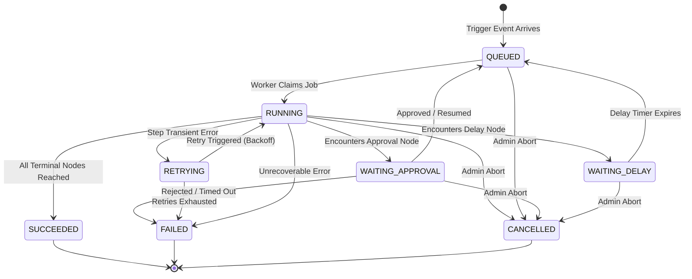

# FlowForge Execution State Machine

## 1. Execution Lifecycle States

## 2. Transition Matrix & Rules

| From State | To State | Trigger / Guard Condition | Invariants & Side Effects |
|---|---|---|---|
| None | `QUEUED` | Workflow triggered manually, via webhook or schedule | Creates execution row in PostgreSQL with status `QUEUED` |
| `QUEUED` | `RUNNING` | Worker picks up BullMQ job | Sets `startedAt` timestamp, locks execution version |
| `RUNNING` | `WAITING_APPROVAL` | Current step is `APPROVAL` | Creates pending `Approval` record; releases worker slot |
| `WAITING_APPROVAL` | `QUEUED` | Actor with valid permissions signs approval | Records approval audit row, sets decision, queues resumption job |
| `WAITING_APPROVAL` | `FAILED` | Approver rejects or approval times out | Marks step `REJECTED`, sets completion timestamp |
| `RUNNING` | `WAITING_DELAY` | Current step is `DELAY` | Schedules delayed queue job or timer record |
| `WAITING_DELAY` | `QUEUED` | Scheduled delay duration elapses | Advances execution pointer beyond delay node |
| `RUNNING` | `RETRYING` | Network timeout or retryable HTTP/Integration error | Increments `retryCount`, computes exponential backoff |
| `RETRYING` | `RUNNING` | Backoff wait completed | Retries the failed node handler |
| `RUNNING` | `SUCCEEDED` | Node reaches `END` with no pending parallel branches | Sets `completedAt`, persists final execution summary |
| `RUNNING` | `FAILED` | Terminal handler error or invalid node output | Sets `completedAt`, persists detailed error context |
| Any non-terminal | `CANCELLED` | Explicit cancellation by Organization Admin | Cancels pending timer, terminates in-flight work |

## 3. Step Execution Record States
Individual nodes have their own step state recorded in `ExecutionStep`:
- `PENDING`: Scheduled for execution
- `RUNNING`: Actively executing in worker
- `COMPLETED`: Finished successfully with output persisted
- `FAILED`: Encountered error, stack trace captured
- `SKIPPED`: Branch was not chosen (e.g., negative branch of condition)
- `WAITING`: Paused for human approval or delay timer
