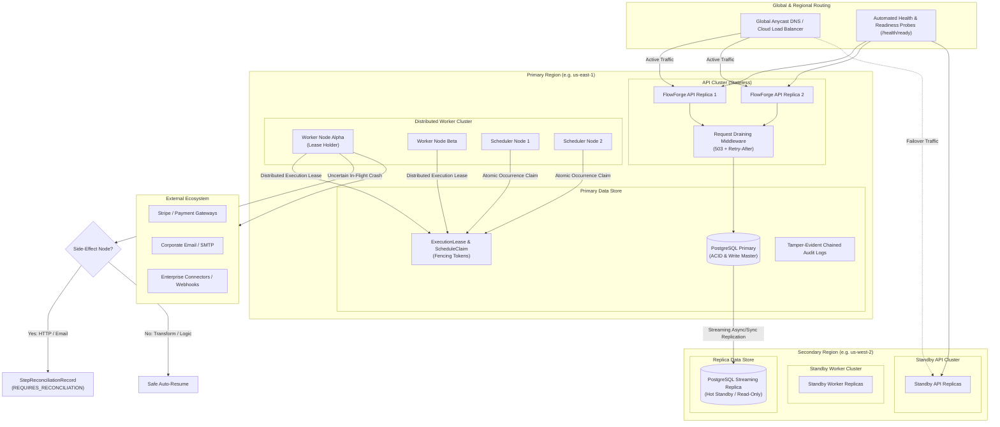

# FlowForge High Availability, Multi-Region Architecture, and Disaster-Resilient Execution

## 1. Overview & Resilience Guarantees

FlowForge is architected as an enterprise-grade, multi-tenant business workflow automation platform built for high availability (HA), zero split-brain execution, and verifiable disaster recovery (DR).

The platform guarantees:

1. **Zero Split-Brain Worker Ownership**: Distributed execution leases with monotonically incrementing renew counts and unique cryptographic fencing tokens (`leaseToken`) prevent concurrent dual-worker execution of the same workflow instance, even under network partitions or garbage collection stalls.
2. **Deterministic Scheduler Deduplication**: Horizontally scaled scheduler replicas claim discrete schedule occurrences atomically in a shared distributed claim store (`ScheduleClaim`), ensuring that recurring cron jobs and one-time schedules trigger exactly once across the cluster.
3. **Uncertain External Side-Effect Protection**: Non-idempotent external actions (`HTTP_REQUEST`, `EMAIL`, `CONNECTOR_ACTION`, `WEBHOOK`) that are interrupted in-flight during a crash or failover are flagged with `REQUIRES_RECONCILIATION`. The platform halts automatic replay of uncertain side effects, providing operators with safe, governed reconciliation paths (`RESUME`, `SKIP`, `FAIL`).
4. **Hitless Traffic Draining & Seamless Switchover**: Graceful shutdown middleware immediately begins shedding new non-health traffic with HTTP `503 Service Unavailable` and `Retry-After: 5` while allowing in-flight HTTP requests and workflow steps to complete cleanly.
5. **Database Resilience & Transactional Integrity**: Idempotent database queries and reads automatically retry against transient connection losses and deadlocks with exponential backoff, while non-idempotent writes fail fast to protect against duplicate partial mutations.
6. **Cryptographic Backup & Snapshot Verification**: Point-in-time recovery (PITR) snapshots are verified using SHA-256 integrity checksums and record counts prior to restore operations.

---

## 2. Architecture & Topology



---

## 3. Distributed Execution Leases & Fencing Tokens

In distributed workflow systems, worker processes may experience temporary network partitions, thread contention, or JVM/V8 garbage collection pauses. Without strict distributed locking, a secondary worker could assume the primary has failed and begin executing steps simultaneously, causing dual execution and data corruption.

### Lease Lifecycle & State Invariants

Each executing workflow instance is guarded by an `ExecutionLeaseRecord` with the following contract:

```typescript
export interface ExecutionLeaseRecord {
  id: string; // `lease_${executionId}`
  executionId: string; // Foreign key to WorkflowExecution
  workerId: string; // Unique worker node identifier
  leaseToken: string; // Cryptographic UUID fencing token
  renewCount: number; // Monotonically increasing renewal counter
  acquiredAt: Date; // Initial acquisition timestamp
  heartbeatAt: Date; // Last heartbeat renewal timestamp
  expiresAt: Date; // Hard lease expiration deadline
}
```

### Operational Rules:

1. **Acquisition**: A worker must successfully acquire an unexpired lease before invoking `processExecution(executionId)`. If another active worker holds the lease and `expiresAt > now`, the acquisition returns `null` and execution is rejected.
2. **Renewal**: The holding worker periodically renews the lease via heartbeats passing the exact `leaseToken`. The renewal advances `expiresAt` by `leaseTtlMs` (default 30 seconds) and increments `renewCount`.
3. **Fencing Protection**: If a stalled worker wakes up and attempts to renew or release with an outdated `leaseToken`, the operation is rejected.
4. **Lease Stealing on Expiry**: If a worker crashes or fails to heartbeat before `expiresAt`, a healthy standby worker can steal the lease, generating a new `leaseToken` and invalidating the crashed worker's rights.

---

## 4. Multi-Replica Distributed Scheduler Deduplication

Horizontal scalability of the scheduler service is critical for high availability. However, running multiple scheduler instances simultaneously risks double-triggering scheduled occurrences (such as payroll runs, invoice generations, or sync jobs).

### Atomic Schedule Occurrence Claims

FlowForge utilizes `ScheduleExecutionClaimRecord` to guarantee occurrence deduplication:

```typescript
export interface ScheduleExecutionClaimRecord {
  id: string; // `claim_${scheduleId}_${occurrenceKey}`
  scheduleId: string; // Schedule reference
  occurrenceKey: string; // Deterministic occurrence identifier (e.g. occ_sched_123_2026-10-31T12:00:00.000Z)
  claimedBy: string; // Unique scheduler instance ID
  claimedAt: Date; // Timestamp when occurrence was claimed
  expiresAt: Date; // Occurrence lease expiry
  executionId?: string; // Resulting execution record ID
}
```

When a schedule becomes due:

1. Every scheduler replica identifies due occurrences using `nextRunAt <= now`.
2. Replicas attempt to register the claim for `claim_${schedule.id}_${targetRunTime.toISOString()}`.
3. The first replica successfully creates the claim and dispatches the execution, while subsequent replicas detect the active unexpired claim and skip execution.
4. Exactly one execution record is created in `db.executions`.

---

## 5. Uncertain Side-Effect Safety & Step Reconciliation

When an execution engine crashes midway through evaluating an external side effect (such as an `HTTP_REQUEST`, `EMAIL`, or `CONNECTOR_ACTION`), the remote service may or may not have processed the mutation. Automatically re-running the step risks double-charging customers or sending duplicate emails.

### Reconciliation State Taxonomy

When `recoverInterruptedExecutions()` or `recoverStaleExecutions()` identifies an interrupted step:

- Pure compute or internal logic nodes (`TRANSFORM`, `CONDITION`, `DELAY`) are safely re-queued.
- External side-effect nodes (`HTTP_REQUEST`, `EMAIL`, `CONNECTOR_ACTION`, `WEBHOOK`) transition the step and execution to `FAILED` with `requiresReconciliation: true`, creating a `StepReconciliationRecord` with status `REQUIRES_RECONCILIATION`.

### Operator Reconciliation API

Operators can review and resolve flagged executions via the Resilience API:

| Action       | Behavior                                                                                                                                                                                                | Target State                                                                    |
| :----------- | :------------------------------------------------------------------------------------------------------------------------------------------------------------------------------------------------------ | :------------------------------------------------------------------------------ |
| **`RESUME`** | Re-queues the step to `PENDING` and resumes workflow execution. Used when the operator verifies the remote service did not process the payload or the remote API is idempotent.                         | Step: `PENDING`<br>Execution: `QUEUED`<br>Reconciliation: `RECONCILED`          |
| **`SKIP`**   | Marks the interrupted step as `COMPLETED` with `{ skippedViaReconciliation: true }` and resumes from subsequent nodes. Used when the operator verifies the side effect completed on the remote service. | Step: `COMPLETED`<br>Execution: `QUEUED`<br>Reconciliation: `MANUALLY_RESOLVED` |
| **`FAIL`**   | Confirms step failure without re-attempting side effects, terminating execution. Used when the external mutation failed or was canceled.                                                                | Step: `FAILED`<br>Execution: `FAILED`<br>Reconciliation: `MANUALLY_RESOLVED`    |

Every reconciliation event is cryptographically recorded in the platform's tamper-evident audit log with hash-chaining.

---

## 6. Application Health, Readiness & Request Draining

FlowForge aligns with standard container orchestrator probe contracts (Kubernetes, AWS ECS, Google Cloud Run):

### Probe Matrix

| Endpoint                | Target             | HTTP Success | HTTP Failure              | Description                                                                                                                                         |
| :---------------------- | :----------------- | :----------- | :------------------------ | :-------------------------------------------------------------------------------------------------------------------------------------------------- |
| **`GET /health`**       | Liveness           | `200 OK`     | `500 Internal Error`      | Checks that the Node.js event loop is responsive. Remains `200` during graceful shutdown so the container is not killed prematurely while draining. |
| **`GET /ready`**        | Readiness          | `200 OK`     | `503 Service Unavailable` | Evaluates database connectivity, circuit breaker health, worker availability, and memory usage. Returns `503` when draining.                        |
| **`GET /health/ready`** | Detailed Readiness | `200 OK`     | `503 Service Unavailable` | Returns full `HealthReadinessDetails` envelope with dependency breakdowns.                                                                          |

### Graceful Draining Sequence

1. **Shutdown Signal (`SIGTERM` / `startGracefulShutdown`)**: The server enters shutting down mode.
2. **Immediate Traffic Shedding**: The readiness probe returns `503 Service Unavailable`. Any new incoming operational API requests receive `503` with `Retry-After: 5` and error code `SERVER_SHUTTING_DOWN`.
3. **In-Flight Draining**: Active HTTP requests and executing steps finish within the configured grace period (e.g. 15-30 seconds).
4. **Worker Lease Release**: Active execution leases are cleanly released in `db.executionLeases`.
5. **Clean Process Termination**: Once `activeRequests === 0`, database pools and connections close cleanly.

---

## 7. Database Resilience & Transient Retries

FlowForge incorporates automated transient fault handling in `ResilienceService`:

### Transient vs Non-Transient Error Taxonomy

- **Transient Errors**: Connection reset (`ECONNRESET`), socket timeouts (`ETIMEDOUT`), broken pipes (`EPIPE`), PostgreSQL deadlocks (`40P01`), serialization failures (`40001`), and pool starvation (`P2024`).
- **Non-Transient Errors**: Validation failures (`VALIDATION_ERROR`), constraint violations (`23505`), syntax errors, and missing foreign keys.

### Idempotency Enforcement Rule:

- **Idempotent operations (`isIdempotent: true`)**: Retried automatically with exponential backoff (e.g. 50ms, 100ms, 200ms) up to `maxRetries` (default 3).
- **Non-idempotent operations (`isIdempotent: false`)**: Fail fast immediately on transient disconnects. Retrying writes without idempotency keys risks duplicate database mutations.

---

## 8. Point-in-Time Recovery & Backup Snapshot Verification

FlowForge backup archives include cryptographic verification metadata:

```bash
POST /api/v1/resilience/backup/verify
Authorization: Bearer <ADMIN_TOKEN>
Content-Type: application/json

{
  "snapshotId": "snap_2026_10_31_pitr",
  "snapshotContent": "{ ... JSON backup archive ... }",
  "expectedSha256": "4b227777d4dd1fc61c6f884f48641d02b4d121d3fd328cb08b5531fcacdabf8a"
}
```

The verification engine:

1. Calculates the SHA-256 digest of the raw snapshot payload.
2. Validates character-for-character parity with `expectedSha256`.
3. Inspects the parsed document structure and verifies entity counts (`recordCount`).
4. Rejects tampered or corrupted snapshots before restore execution.

---

## 9. API Reference & Operator Endpoints

| Method | Endpoint                                    | Permission         | Description                                                                     |
| :----- | :------------------------------------------ | :----------------- | :------------------------------------------------------------------------------ |
| `GET`  | `/ready`                                    | Public             | Cluster readiness probe. Returns `200` if ready, `503` if degraded or draining. |
| `GET`  | `/health/ready`                             | Public             | Returns full `HealthReadinessDetails` dependency breakdown.                     |
| `GET`  | `/api/v1/resilience/leases`                 | `resilience:read`  | Lists active distributed execution leases and scheduler occurrence claims.      |
| `GET`  | `/api/v1/resilience/reconciliations`        | `resilience:read`  | Lists pending uncertain side-effect step reconciliations.                       |
| `POST` | `/api/v1/resilience/reconcile/:executionId` | `resilience:admin` | Reconciles an execution step (`RESUME`, `SKIP`, `FAIL`).                        |
| `POST` | `/api/v1/resilience/failover/simulate`      | `resilience:admin` | Simulates regional failover switchover and traffic draining.                    |
| `POST` | `/api/v1/resilience/backup/verify`          | `resilience:admin` | Cryptographically validates point-in-time recovery backup snapshots.            |
