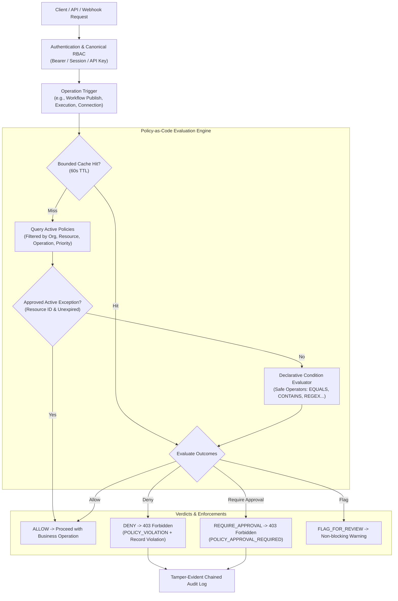

# FlowForge Policy-as-Code, Automated Governance, and Compliance Enforcement

## 1. Executive Summary & Guarantees

FlowForge incorporates a centralized, versioned, testable Policy-as-Code (PaC) system that empowers enterprises and regulated organizations to define, evaluate, enforce, and audit governance rules across workflows, integration connections, credentials, extensions, execution operations, and data classifications.

The policy engine operates as a declarative governance layer that complements and strengthens canonical role-based access control (RBAC), without creating parallel identity silos or bypassing tenant isolation.

### Core Guarantees:

1. **Deterministic Evaluation & Deny-Overrides**: If any active applicable rule evaluates to `DENY`, the entire operation is blocked, returning structured reason codes and actionable remediation guidance.
2. **Safe Rule Condition Engine**: Rule conditions are strictly declarative. Arbitrary script execution, dynamic `eval()`, and unrestricted shell execution are structurally impossible.
3. **Dual-Control Policy Lifecycle**: Policies advance through explicit lifecycle states (`DRAFT` → `IN_REVIEW` → `APPROVED` → `ACTIVE` → `SUSPENDED` / `RETIRED`). Policy approval requires dual authorization; the author cannot approve their own policy unless possessing root `OWNER` privileges.
4. **Immutable Version Snapshots & Rollback**: Every approval creates an immutable version snapshot (`PolicyVersionRecord`), guaranteeing verifiable historical auditability and single-click rollbacks.
5. **Time-Limited Governed Exceptions**: Authorized administrators can grant scoped, time-limited policy exceptions (`PolicyExceptionRecord`) with automatic expiration and audit chaining.
6. **Zero-Side-Effect Simulation Engine**: A dry-run simulation endpoint (`/simulate`) evaluates proposed policy rules against synthetic contexts without executing business operations, dispatching outbound requests, or mutating database state.
7. **Compliance Control Mapping**: Policies map directly to standard compliance controls (`SOC2_CC6_1`, `ISO27001_A9`, `GDPR_ART32`, `HIPAA_164_312`, `PCI_DSS_6_4`).

---

## 2. Architecture & Evaluation Pipeline



---

## 3. Policy Specification & Rule Grammar

Policies are defined in a strict, JSON-serializable grammar validated by Zod schemas (`PolicyRuleSchema`, `CreatePolicySchema`):

```typescript
export interface PolicyRule {
  id: string; // e.g. "rule_restrict_domains"
  name: string; // Descriptive rule title
  description?: string;
  conditions: PolicyRuleCondition[]; // Evaluated according to logicalOperator
  logicalOperator: "AND" | "OR"; // Default: "AND"
  outcome:
    "ALLOW" | "DENY" | "REQUIRE_APPROVAL" | "REQUIRE_AUDIT" | "FLAG_FOR_REVIEW";
  requiredRole?: Role; // Required approver role if REQUIRE_APPROVAL
  severity: "CRITICAL" | "HIGH" | "MEDIUM" | "LOW";
  reasonCode: string; // Machine-readable diagnostic code
  message: string; // User-facing remediation instructions
}
```

### Supported Condition Operators

| Operator        | Target Types            | Description                                          | Missing Value Behavior |
| :-------------- | :---------------------- | :--------------------------------------------------- | :--------------------- |
| `EQUALS`        | String, Number, Boolean | Exact value equality                                 | Evaluates to `false`   |
| `NOT_EQUALS`    | String, Number, Boolean | Value inequality                                     | Evaluates to `true`    |
| `CONTAINS`      | Array, String           | Array inclusion or substring match                   | Evaluates to `false`   |
| `NOT_CONTAINS`  | Array, String           | Negative inclusion or substring exclusion            | Evaluates to `true`    |
| `IN`            | String, Number          | Actual value exists in condition array               | Evaluates to `false`   |
| `NOT_IN`        | String, Number          | Actual value absent from condition array             | Evaluates to `true`    |
| `GREATER_THAN`  | Number                  | Numeric strict inequality (`actual > value`)         | Evaluates to `false`   |
| `LESS_THAN`     | Number                  | Numeric strict inequality (`actual < value`)         | Evaluates to `false`   |
| `MATCHES_REGEX` | String                  | Regular expression match (length bounded ≤ 100)      | Evaluates to `false`   |
| `IS_EMPTY`      | Any                     | Checks null, undefined, empty string, or empty array | Evaluates to `true`    |
| `IS_NOT_EMPTY`  | Any                     | Checks non-null, non-empty content                   | Evaluates to `false`   |

---

## 4. Workflow Lifecycle Integration

### Publication Gate (`POST /api/v1/workflows/:id/publish`)

Before creating an immutable workflow version or changing workflow status to `ACTIVE`, the engine extracts contextual graph attributes:

- `nodeTypes`: List of all node types in the graph (`TRIGGER`, `HTTP_REQUEST`, `EXTENSION_NODE`, etc.).
- `destinationDomains`: Parsed domain hostnames from all outbound HTTP request URLs.
- `nodeCount`: Graph complexity size.
- `dataClassification`: Sensitivity label (`PUBLIC`, `INTERNAL`, `CONFIDENTIAL`, `RESTRICTED`).
- `riskClassification`: Operational criticality.

If policy evaluation produces `DENY`, publication is rejected with HTTP `403 Forbidden` (`code: POLICY_VIOLATION`), and an entry is logged in `policy_violations`. If the policy requires approval (`code: POLICY_APPROVAL_REQUIRED`), publication halts until an authorized administrator grants approval.

### Draft Validation (`POST /api/v1/workflows/:id/validate`)

During workflow editing and validation, policy evaluation runs in parallel with graph connectivity checks. The response includes both graph status and a `policyDecision` object surfacing warnings and potential blocking rules before the user attempts publication.

---

## 5. Exceptions, Overrides, and Violations

### Time-Limited Exceptions

When urgent operational needs arise that violate an active policy, users with `policy:write` can submit an exception request specifying:

- Policy and rule identifier.
- Affected resource ID and operation.
- Justification and expiration window (1 to 720 hours).

Administrators (`policy:admin`) review and approve or reject the request. Approved exceptions bypass only the specified rule for the target resource until `expiresAt`.

### Violations Tracking & Drift Management

Violations automatically generate persistent records (`PolicyViolationRecord`) with status workflows:

- `OPEN`: Detected violation requiring remediation.
- `ACKNOWLEDGED`: Acknowledged by operational owner.
- `EXCEPTION_GRANTED`: Temporarily superseded by an approved exception.
- `RESOLVED`: Resolved and closed with remediation notes and timestamp.

---

## 6. API Reference

| Method  | Endpoint                                                   | Permission        | Description                                                 |
| :------ | :--------------------------------------------------------- | :---------------- | :---------------------------------------------------------- |
| `GET`   | `/api/v1/organizations/:id/policies`                       | `policy:read`     | List organization policies with status and category filters |
| `POST`  | `/api/v1/organizations/:id/policies`                       | `policy:write`    | Create a draft policy with validation                       |
| `GET`   | `/api/v1/organizations/:id/policies/:policyId`             | `policy:read`     | Get policy details and rules                                |
| `PATCH` | `/api/v1/organizations/:id/policies/:policyId`             | `policy:write`    | Update draft policy definition                              |
| `POST`  | `/api/v1/organizations/:id/policies/:policyId/review`      | `policy:write`    | Submit draft policy for administrative review               |
| `POST`  | `/api/v1/organizations/:id/policies/:policyId/approve`     | `policy:admin`    | Dual-control approval creating immutable version snapshot   |
| `POST`  | `/api/v1/organizations/:id/policies/:policyId/activate`    | `policy:admin`    | Activate approved policy across tenant operations           |
| `POST`  | `/api/v1/organizations/:id/policies/:policyId/suspend`     | `policy:admin`    | Suspend active policy enforcement                           |
| `POST`  | `/api/v1/organizations/:id/policies/:policyId/rollback`    | `policy:admin`    | Roll back policy to an earlier version snapshot             |
| `POST`  | `/api/v1/organizations/:id/policies/:policyId/retire`      | `policy:admin`    | Retire policy permanently                                   |
| `POST`  | `/api/v1/organizations/:id/policies/evaluate`              | `policy:evaluate` | Authoritative server-side policy evaluation                 |
| `POST`  | `/api/v1/organizations/:id/policies/simulate`              | `policy:read`     | Dry-run preview evaluation of draft rules                   |
| `GET`   | `/api/v1/organizations/:id/policies/exceptions`            | `policy:read`     | List active and historical policy exceptions                |
| `POST`  | `/api/v1/organizations/:id/policies/exceptions`            | `policy:write`    | Request time-limited policy exception                       |
| `POST`  | `/api/v1/organizations/:id/policies/exceptions/:id/decide` | `policy:admin`    | Approve or reject policy exception                          |
| `GET`   | `/api/v1/organizations/:id/policies/violations`            | `policy:read`     | List detected policy violations                             |
| `PATCH` | `/api/v1/organizations/:id/policies/violations/:id`        | `policy:admin`    | Assign owner or update remediation status                   |

---

## 7. Performance & Caching

- **Bounded Deterministic Cache**: Policy evaluations are cached using an SHA-256 fingerprint of `(organizationId, workspaceId, resourceType, resourceId, operation, attributes, policyVersionHash)` with a 60-second TTL and 1,000-entry capacity limit.
- **Immediate Invalidation**: Any policy creation, update, activation, suspension, rollback, or exception approval immediately flushes the evaluation cache to guarantee instant consistency.
- **ReDoS Safety**: All regex patterns are restricted to a maximum length of 100 characters and executed within protected try-catch wrappers to eliminate catastrophic backtracking risks.
