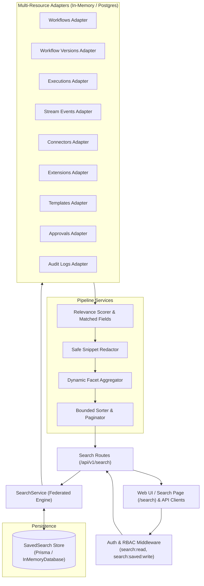

# FlowForge Unified Search, Enterprise Data Discovery, and Operational Intelligence

## 1. Overview & Guarantees

FlowForge Unified Search provides an enterprise-grade, single-pane discovery capability across all core business entities. It allows authorized users to locate, inspect, and navigate workflows, immutable version snapshots, executions, high-throughput stream events, integration connectors, extension packages, marketplace templates, human-in-the-loop approvals, and security audit logs through a consistent interface.

### Guarantees

1. **Strict Multi-Tenant and Workspace Isolation**: Every search query is constrained by the caller's verified `organizationId` and optional `workspaceId`. Cross-tenant data leakage is structurally impossible.
2. **Fine-Grained Role-Based Access Control (RBAC)**: Resource access is evaluated at the adapter level. For example, audit records require `audit:read` or `compliance:read`, approvals require `approval:read`, and integration connectors require `connections:read`. Users without necessary permissions receive filtered results without exposure of unauthorized resource types or counts.
3. **Sensitive Credential Protection & Safe Snippet Generation**: Search result snippets and summaries automatically redact secrets, auth tokens, client secrets, private keys, passwords, and webhook signatures. Raw ciphertexts or credentials are never indexed or returned.
4. **Deterministic Relevance Scoring**: Queries prioritize exact ID matches (`score: 100`) and exact title matches (`score: 90`), followed by title prefix matches (`score: 50`), title substrings (`score: 30`), description contents (`score: 15`), and tags (`score: 15`).
5. **Bounded Pagination & Dynamic Faceting**: All queries enforce strict pagination limits (`max pageSize: 100`), preventing memory exhaustion, and return dynamic aggregations by resource type and status.
6. **Saved Searches & Operational Productivity**: Users can persist complex search configurations as private or organization-shared queries with optional default workspace scoping.

---

## 2. Architecture & Federation Model



---

## 3. Resource Adapters & Data Mapping

| Resource Type      | Underlying Entity             | Permissions Required             | Canonical Navigation URL  | Key Searchable Fields                           |
| :----------------- | :---------------------------- | :------------------------------- | :------------------------ | :---------------------------------------------- |
| `workflow`         | `WorkflowRecord`              | `workflow:read`                  | `/workflows/{id}`         | `id`, `name`, `description`, `tags`             |
| `workflow_version` | `WorkflowVersionRecord`       | `workflow:read`                  | `/workflows/{workflowId}` | `id`, `workflow.name`, `versionNumber`          |
| `execution`        | `WorkflowExecutionRecord`     | `workflow:read`                  | `/executions/{id}`        | `id`, `workflow.name`, `status`, `errorDetails` |
| `event`            | `StreamEventRecord`           | `events:read`                    | `/events`                 | `id`, `type`, `source`, `correlationId`         |
| `connector`        | `IntegrationConnectionRecord` | `connections:read`               | `/settings`               | `id`, `name`, `connectorId`, `authType`         |
| `extension`        | `ExtensionPackageRecord`      | `extensions:read`                | `/settings`               | `id`, `name`, `description`, `publisherName`    |
| `template`         | `WorkflowTemplateRecord`      | `templates:read`                 | `/templates`              | `id`, `name`, `shortDescription`, `tags`        |
| `approval`         | `ApprovalRecord`              | `approval:read`                  | `/approvals`              | `id`, `title`, `description`, `requiredRole`    |
| `audit_log`        | `AuditLogRecord`              | `audit:read` / `compliance:read` | `/settings`               | `id`, `action`, `resourceType`, `resourceId`    |

---

## 4. Relevance Scoring & Field Attribution

When a text query is provided, every resource evaluated by an adapter is scored according to the following weights:

```typescript
// Relevance scoring breakdown
1. Exact ID Match:        +100 points  (matchedFields: ["id"])
2. ID Substring Match:    +40 points   (matchedFields: ["id"])
3. Exact Title Match:     +90 points   (matchedFields: ["title"])
4. Title Prefix Match:    +50 points   (matchedFields: ["title"])
5. Title Substring Match: +30 points   (matchedFields: ["title"])
6. Description Match:     +15 points   (matchedFields: ["description"])
7. Tag Match:             +15 points   (matchedFields: ["tags"])
```

If a text query is present and an item's score evaluates to `0`, it is excluded from search results. When no query string is provided (e.g., broad filter exploration), a baseline score of `10` is assigned.

Results can be sorted by `relevance` (default, descending score), `createdAt`, `updatedAt`, or `title`.

---

## 5. Sensitive Data Redaction & Snippet Generation

To prevent inadvertent credential leakage in search cards or snippet previews:

- Any text containing sensitive markers (such as `token`, `secret`, `password`, `bearer`, `aes256`, `api_key`, `key=`, or `auth=`) is automatically scrubbed.
- Matched text substrings are extracted into a bounded context snippet (maximum 160 characters) surrounding the first query occurrence with `...` truncation.
- Raw encrypted credentials (`encryptedData`, `clientSecret`, `privateKey`) are excluded from result schemas and metadata payloads.

---

## 6. Saved Searches Subsystem

Users can create and share search shortcuts across their organization or maintain private searches.

### Database Schema (`SavedSearch`)

```prisma
model SavedSearch {
  id             String        @id @default(uuid())
  organizationId String
  workspaceId    String?
  userId         String
  name           String
  description    String?
  query          Json
  isShared       Boolean       @default(false)
  createdAt      DateTime      @default(now())
  updatedAt      DateTime      @updatedAt

  organization   Organization  @relation(fields: [organizationId], references: [id], onDelete: Cascade)
  user           User          @relation(fields: [userId], references: [id], onDelete: Cascade)

  @@index([organizationId, userId])
  @@index([organizationId, isShared])
  @@map("saved_searches")
}
```

### Access Model

- **Reading**: Users can view their own saved searches (`userId == caller.id`) and all shared searches in the organization (`isShared == true`).
- **Creating**: Requires permission `search:saved:write` (granted to `OWNER`, `ADMIN`, `MEMBER`).
- **Deleting**: Only the creator or an organization administrator (`OWNER` or `ADMIN`) may delete a saved search.

---

## 7. Search Observability & Operational Metrics

The search engine tracks real-time performance indicators to support SLA monitoring:

- `totalSearches`: Cumulative search requests served.
- `avgDurationMs`: Rolling average search query latency.
- `slowQueriesCount`: Queries taking longer than 250ms.
- `searchesByType`: Cumulative search volume broken down by target resource type.

Metrics can be queried via `GET /api/v1/search/metrics` by authorized operators with `analytics:read` or `search:read` permissions.

---

## 8. Web Interface (`/search`)

The Next.js 14 frontend provides a unified operational dashboard:

- **Instant Search Bar**: Debounced text search with clear buttons and active filters indicator.
- **Resource Chips**: Quick toggle filters for Workflows, Versions, Executions, Connectors, Extensions, Templates, Approvals, Events, and Audit Logs.
- **Status & Sort Dropdowns**: Direct filtering by state (`ACTIVE`, `SUCCEEDED`, `FAILED`, `PENDING`, `PUBLISHED`) and sorting order.
- **Matched Fields Badges**: Highlights whether the match occurred on ID, Title, Description, or Tags.
- **Direct Navigation Links**: Cards route directly to the canonical detail view for each respective resource.
- **Saved Searches Modal**: One-click modal to save current query configurations or re-execute previously saved queries.
